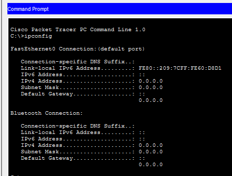
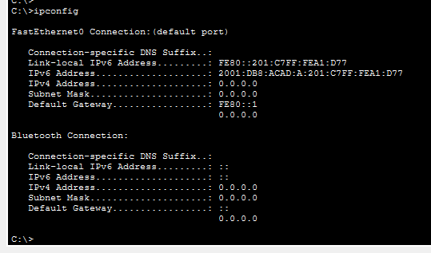
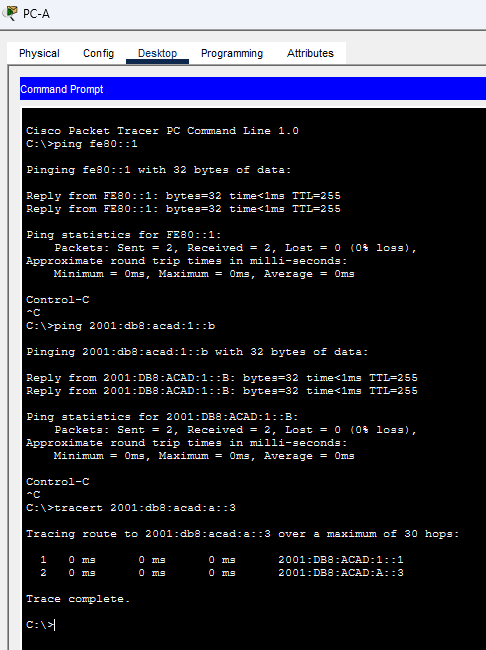
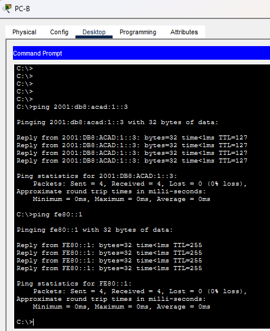

# Лабораторная работа. Настройка IPv6-адресов на сетевых устройствах 

## Топология

 

## Таблица адресации

|Устройство|Интерфейс|IPv6-адрес|Link local IPv6-адрес|Длина префикса|Шлюз по умолчанию|
|-|-|-|-|-|-|
|R1|G0/0/0|2001:db8:acad:a::1|fe80::1|64| — |
|R1|G0/0/1|2001:db8:acad:1::1|fe80::1|64| — |
|S1|VLAN 1|2001:db8:acad:1::b|fe80::b|64| — |
|PC-A|NIC|2001:db8:acad:1::3|SLACC|64|fe80::1|
|PC-B|NIC|2001:db8:acad:a::3|SLACC|64|fe80::1|

## Задачи
Часть 1. Настройка топологии и конфигурация основных параметров маршрутизатора и коммутатора

Часть 2. Ручная настройка IPv6-адресов

Часть 3. Проверка сквозного соединения

## Общие сведения/сценарий

В этой лабораторной работе  вы будете настраивать хосты и интерфейсы устройств с IPv6-адресами.  Для просмотра индивидуальных и групповых IPv6-адресов вы будете использовать команду **show**. Вы также будете проверять сквозное соединение с помощью команд **ping** and **traceroute**.

**Примечание**: Маршрутизаторы, используемые в практических лабораторных работах CCNA, - это Cisco 4221 с Cisco IOS XE Release 16.9.4 (образ universalk9). В лабораторных работах используются коммутаторы Cisco Catalyst 2960 с Cisco IOS версии 15.2(2) (образ lanbasek9). Можно использовать другие маршрутизаторы, коммутаторы и версии Cisco IOS. В зависимости от модели устройства и версии Cisco IOS доступные команды и результаты их выполнения могут отличаться от тех, которые показаны в лабораторных работах. Правильные идентификаторы интерфейса см. в сводной таблице по интерфейсам маршрутизаторов в конце лабораторной работы.

**Примечание**:  Убедитесь, что у всех маршрутизаторов и коммутаторов была удалена начальная конфигурация. Если вы не уверены, обратитесь к инструктору.

**Примечание**. Шаблон по умолчанию менеджера базы данных 2960 Switch Database Manager (SDM) не поддерживает IPv6. Перед назначением IPv6-адреса SVI VLAN 1 может понадобиться выполнение команды sdm prefer dual-ipv4-and-ipv6 default **для включения IPv6-адресации**.

**Примечание**. **Шаблон default bias**, который по умолчанию используется диспетчером SDM (диспетчер базы данных коммутатора), не предоставляет возможностей адресации IPv6. Убедитесь, что SDM использует шаблон dual-ipv4-and-ipv6 или **lanbase-routing**. Новый шаблон будет использоваться после перезагрузки.
```
S1# show sdm prefer
```
Чтобы установить шаблон dual-ipv4-and-ipv6 в качестве шаблона SDM по умолчанию, выполните следующие действия:

```
S1# configure terminal
S1(config)# sdm prefer dual-ipv4-and-ipv6 default
S1(config)# end
S1# reload
```

## Необходимые ресурсы
•	1 Маршрутизатор (Cisco 4221 с универсальным образом Cisco IOS XE версии 16.9.4 или аналогичным)

•	1 коммутатор (Cisco 2960 с ПО Cisco IOS версии 15.2(2) с образом lanbasek9 или аналогичная модель)

•	2 ПК (Windows и программа эмуляции терминала, такая как Tera Term)

•	Консольные кабели для настройки устройств Cisco IOS через консольные порты.

•	Кабели Ethernet, расположенные в соответствии с топологией

Примечание. **Интерфейсы Gigabit Ethernet на маршрутизаторах Cisco 4221 определяют скорость автоматически, поэтому для подключения маршрутизатора к PC-B можно использовать прямой кабель Ethernet. При использовании другой модели маршрутизатора Cisco может возникнуть необходимость использовать перекрестный кабель Ethernet**.

## Инструкции
### Часть 1. Настройка топологии и конфигурация основных параметров маршрутизатора и коммутатора

После подключения сети, инициализации и перезагрузки маршрутизатора и коммутатора выполните следующие действия:

#### Шаг 1. Настройте маршрутизатор.

Назначьте имя хоста и настройте основные параметры устройства.
```
Switch>
Switch>en
Switch#cong t
            ^
% Invalid input detected at '^' marker.
	
Switch#conf t
Enter configuration commands, one per line.  End with CNTL/Z.
Switch(config)#no ip do
Switch(config)#no ip do
Switch(config)#no ip do
Switch(config)#no ip do,
Switch(config)#no ip dom
Switch(config)#no ip doma
Switch(config)#no ip domain-lookup
Switch(config)#hostname S1
S1(config)#sev
S1(config)#sev
S1(config)#sev
S1(config)#sev
S1(config)#serv
S1(config)#service pas
S1(config)#service password-encryption 
S1(config)#enab
S1(config)#enable ser
S1(config)#enable serv
S1(config)#enable sec
S1(config)#enable secret cla
S1(config)#enable secret class
S1(config)#bann
S1(config)#banner mod #
                    ^
% Invalid input detected at '^' marker.
	
S1(config)#banner motd #
Enter TEXT message.  End with the character '#'.
UHODI #

S1(config)#line con 0
S1(config-line)#login
% Login disabled on line 0, until 'password' is set
S1(config-line)#secr
S1(config-line)#secr
S1(config-line)#secr
S1(config-line)#pas
S1(config-line)#password cisco
S1(config-line)#login
S1(config-line)#loggi
S1(config-line)#logging sy
S1(config-line)#logging synchronous 
S1(config-line)#exit
S1(config)#line vty 0-4
                    ^
% Invalid input detected at '^' marker.
	
S1(config)#line vty 0 4
S1(config-line)#pas
S1(config-line)#password cisco
S1(config-line)#login
S1(config-line)#exit
S1(config)#inter
S1(config)#interface vla
S1(config)#interface vlan 1
S1(config-if)#no shutdown
S1(config-if)#exit
S1(config)#line con 0
S1(config-line)#log
S1(config-line)#logg
S1(config-line)#logging syn
S1(config-line)#logging synchronous 
S1(config-line)#exit
S1(config)#
	
S1(config)#
S1(config)#sdm prefer dual-ipv4-and-ipv6
% Incomplete command.
S1(config)#sdm prefer dual-ipv4-and-ipv6
S1(config)#sdm prefer dual-ipv4-and-ipv6 
S1(config)#sdm prefer dual-ipv4-and-ipv6 default 
S1(config)#sdm prefer dual-ipv4-and-ipv6 default 
S1(config)#sdm prefer dual-ipv4-and-ipv6 default 
S1(config)#sdm prefer dual-ipv4-and-ipv6 default 
Changes to the running SDM preferences have been stored, but cannot take effect until the next reload.
Use 'show sdm prefer' to see what SDM preference is currently active.
S1(config)#show sdm prefer
            ^
% Invalid input detected at '^' marker.
	
S1(config)#exit
S1#
%SYS-5-CONFIG_I: Configured from console by console

S1#show sdm prefer
 The current template is "default" template.
 The selected template optimizes the resources in
 the switch to support this level of features for
 0 routed interfaces and 1024 VLANs.

  number of unicast mac addresses:                  8K
  number of IPv4 IGMP groups + multicast routes:    0.25K
  number of IPv4 unicast routes:                    0
  number of IPv6 multicast groups:                  0
  number of directly-connected IPv6 addresses:      0
  number of indirect IPv6 unicast routes:           0
  number of IPv4 policy based routing aces:         0
  number of IPv4/MAC qos aces:                      0.125k
  number of IPv4/MAC security aces:                 0.375k
  number of IPv6 policy based routing aces:         0
  number of IPv6 qos aces:                          20
  number of IPv6 security aces:                     25

 On next reload, template will be "dual-ipv4-and-ipv6 default" template.
S1#reload
System configuration has been modified. Save? [yes/no]:yes
Building configuration...
[OK]
Proceed with reload? [confirm]
C2960 Boot Loader (C2960-HBOOT-M) Version 12.2(25r)FX, RELEASE SOFTWARE (fc4)
Cisco WS-C2960-24TT (RC32300) processor (revision C0) with 21039K bytes of memory.
2960-24TT starting...
Base ethernet MAC Address: 0060.7012.C030
Xmodem file system is available.
Initializing Flash...
flashfs[0]: 2 files, 0 directories
flashfs[0]: 0 orphaned files, 0 orphaned directories
flashfs[0]: Total bytes: 64016384
flashfs[0]: Bytes used: 4671687
flashfs[0]: Bytes available: 59344697
flashfs[0]: flashfs fsck took 1 seconds.
...done Initializing Flash.
...

...
Copyright (c) 1986-2013 by Cisco Systems, Inc.
Compiled Wed 26-Jun-13 02:49 by mnguyen


Press RETURN to get started!


UHODI 

User Access Verification

Password: 

S1>en
Password: 
S1#show sdm prefer
 The current template is "dual-ipv4-and-ipv6 default" template.
 The selected template optimizes the resources in
 the switch to support this level of features for
 0 routed interfaces and 1024 VLANs.

  number of unicast mac addresses:                  4K
  number of IPv4 IGMP groups + multicast routes:    0.25K
  number of IPv4 unicast routes:                    0
  number of IPv6 multicast groups:                  0.375k
  number of directly-connected IPv6 addresses:      0
  number of indirect IPv6 unicast routes:           0
  number of IPv4 policy based routing aces:         0
  number of IPv4/MAC qos aces:                      0.125K
  number of IPv4/MAC security aces:                 0.375K
  number of IPv6 policy based routing aces:         0
  number of IPv6 qos aces:                          0.625k
  number of IPv6 security aces:                     0.125K

S1#
```


#### Шаг 2. Настройте коммутатор.
Назначьте имя хоста и настройте основные параметры устройства.

```
Router>en
Router#conf t
Enter configuration commands, one per line.  End with CNTL/Z.
Router(config)#hostname R1
R1(config)#no ip domain-lookup
R1(config)#enab
R1(config)#enable secrw
R1(config)#enable secre
R1(config)#enable secret class
R1(config)#line con
R1(config)#line console 0
R1(config-line)#passw
R1(config-line)#password cisco
R1(config-line)#login
R1(config-line)#log
R1(config-line)#log
R1(config-line)#log
R1(config-line)#loggi
R1(config-line)#logging syn
R1(config-line)#logging synchronous 
R1(config-line)#exit
R1(config)#line vty 0 4
R1(config-line)#pass
R1(config-line)#password cisco
R1(config-line)#login
R1(config-line)#exit
R1(config)#line vty 0 4
R1(config-line)#trans
R1(config-line)#transport input ssh
R1(config-line)#exit
R1(config)#servic
R1(config)#service pass
R1(config)#service password-encryption 
R1(config)#bann
R1(config)#banner mo
R1(config)#banner motd # Uhodi #
R1(config)#
R1(config)#int gigabitEthernet 0/0/0
R1(config-if)#no shutdown

R1(config-if)#
%LINK-5-CHANGED: Interface GigabitEthernet0/0/0, changed state to up

%LINEPROTO-5-UPDOWN: Line protocol on Interface GigabitEthernet0/0/0, changed state to up

R1(config-if)#int gigabitEthernet 0/0/1
R1(config-if)#no shutdown

R1(config-if)#
%LINK-5-CHANGED: Interface GigabitEthernet0/0/1, changed state to up

%LINEPROTO-5-UPDOWN: Line protocol on Interface GigabitEthernet0/0/1, changed state to up

R1(config-if)#
```

### Часть 2. Ручная настройка IPv6-адресов

#### Шаг 1. Назначьте IPv6-адреса интерфейсам Ethernet на R1.

a.	Назначьте глобальные индивидуальные IPv6-адреса, указанные в таблице адресации обоим интерфейсам Ethernet на R1.
```
R1>en
Password: 
R1#conf t
Enter configuration commands, one per line.  End with CNTL/Z.
R1(config)#int 
R1(config)#int g0/0/0
R1(config-if)#ipv6 address 2001:db8:acad:a::1
% Incomplete command.
R1(config-if)#ipv6 address 2001:db8:acad:a::1/64
R1(config-if)#int g0/0/1
R1(config-if)#ipv6 address 2001:db8:acad:1::1/64
R1(config-if)#
```

b.	Введите команду show ipv6 interface brief, чтобы проверить, назначен ли каждому интерфейсу корректный индивидуальный IPv6-адрес.

```
R1#show ipv6 interface brief
GigabitEthernet0/0/0       [up/up]
    FE80::202:17FF:FE66:9A01
    2001:DB8:ACAD:A::1
GigabitEthernet0/0/1       [up/up]
    FE80::202:17FF:FE66:9A02
    2001:DB8:ACAD:1::1
Vlan1                      [administratively down/down]
    unassigned
R1#
```

Примечание. **Отображаемый локальный адрес канала основан на адресации EUI-64, которая автоматически использует MAC-адрес интерфейса для создания 128-битного локального IPv6-адреса канала**.

c.	Чтобы обеспечить соответствие локальных адресов канала индивидуальному адресу, вручную введите локальные адреса канала на каждом интерфейсе Ethernet на R1.

```
R1#conf t
Enter configuration commands, one per line.  End with CNTL/Z.
R1(config)#int g0/0/1
R1(config-if)#ipv6 address fe80::1 link-local
R1(config-if)#int g0/0/1
R1#
%SYS-5-CONFIG_I: Configured from console by console

R1#conf t
Enter configuration commands, one per line.  End with CNTL/Z.
R1(config)#int g0/0/0
R1(config-if)#ipv6 address fe80::1 link-local
R1(config-if)#end
R1#
%SYS-5-CONFIG_I: Configured from console by console

R1#
```

**Примечание**. Каждый интерфейс маршрутизатора относится к отдельной сети. Пакеты с локальным адресом канала никогда не выходят за пределы локальной сети, а значит, для обоих интерфейсов можно указывать один и тот же локальный адрес канала.

d.	Используйте выбранную команду, чтобы убедиться, что локальный адрес связи изменен на fe80::1.  

```
R1#show ipv6 interface brief
GigabitEthernet0/0/0       [up/up]
    FE80::1
    2001:DB8:ACAD:A::1
GigabitEthernet0/0/1       [up/up]
    FE80::1
    2001:DB8:ACAD:1::1
Vlan1                      [administratively down/down]
    unassigned
R1#show ipv6 interface g0/0/0
GigabitEthernet0/0/0 is up, line protocol is up
  IPv6 is enabled, link-local address is FE80::1
  No Virtual link-local address(es):
  Global unicast address(es):
    2001:DB8:ACAD:A::1, subnet is 2001:DB8:ACAD:A::/64
  Joined group address(es):
    FF02::1
    FF02::1:FF00:1
  MTU is 1500 bytes
  ICMP error messages limited to one every 100 milliseconds
  ICMP redirects are enabled
  ICMP unreachables are sent
  ND DAD is enabled, number of DAD attempts: 1
  ND reachable time is 30000 milliseconds
R1#
```

Закройте окно настройки.

**Вопрос**:
Какие группы многоадресной рассылки назначены интерфейсу G0/0?

**Ответ**: 
Группы
  Joined group address(es):
    FF02::1
    FF02::1:FF00:1

### Шаг 2. Активируйте IPv6-маршрутизацию на R1.

a.	В командной строке на PC-B введите команду ipconfig, чтобы получить данные IPv6-адреса, назначенного интерфейсу ПК.



**Вопрос**:
Назначен ли индивидуальный IPv6-адрес сетевой интерфейсной карте (NIC) на PC-B?

**Ответ**: Нет, назначен только link-local адрес

b.	Активируйте IPv6-маршрутизацию на R1 с помощью команды IPv6 unicast-routing.

```
R1# conf t
Enter configuration commands, one per line.  End with CNTL/Z.
R1(config)#ipv6 unica
R1(config)#ipv6 unicast-routing 
R1(config)#end
R1#
%SYS-5-CONFIG_I: Configured from console by console

R1#
```

чтобы убедиться, что новая многоадресная группа назначена интерфейсу G0/0/0. Обратите внимание, что в списке групп для интерфейса G0/0 отображается группа многоадресной рассылки всех маршрутизаторов (FF02::2).

**Примечание**. Это позволит компьютерам получать IP-адреса и данные шлюза по умолчанию с помощью функции SLAAC (Stateless Address Autoconfiguration (Автоконфигурация без сохранения состояния адреса)).

c.	Теперь, когда R1 входит в группу многоадресной рассылки всех маршрутизаторов, еще раз введите команду ipconfig на PC-B. Проверьте данные IPv6-адреса.



**Вопрос**:
Почему PC-B получил глобальный префикс маршрутизации и идентификатор подсети, которые вы настроили на R1?

**Ответ**: Потому что после ipv6 unicast-routing R1 начал рассылать Router Advertisement (RA) на G0/0/0 (в группу FF02::1), и PC-B по механизму SLAAC сформировал свой глобальный адрес: префикс 2001:db8:acad:a::/64 (из RA) + свой interface identifier (EUI-64 из MAC). Шлюзом по умолчанию PC-B автоматически взял link-local адрес R1 — fe80::1

### Шаг 3. Назначьте IPv6-адреса интерфейсу управления (SVI) на S1.

a.	Назначьте адрес IPv6 для S1. Также назначьте этому интерфейсу локальный адрес канала fe80::b.
```
S1(config)#interface vlan 1
S1(config-if)#ipv6 addre
S1(config-if)#ipv6 address 2001:db8:acad:1::b/64
S1(config-if)#ipv6 address fe80::b link
S1(config-if)#ipv6 address fe80::b link-local 
S1(config-if)#no shutdown
S1(config-if)#exit
```
b.	Проверьте правильность назначения IPv6-адресов интерфейсу управления с помощью команды show ipv6 interface vlan1.
```
S1#show ipv6 inter
S1#show ipv6 interface vlan1
                           ^
% Invalid input detected at '^' marker.
	
S1#show ipv6 interface vlan
S1#show ipv6 interface vlan 1
Vlan1 is up, line protocol is up
  IPv6 is enabled, link-local address is FE80::B
  No Virtual link-local address(es):
  Global unicast address(es):
    2001:DB8:ACAD:1::B, subnet is 2001:DB8:ACAD:1::/64
  Joined group address(es):
    FF02::1
    FF02::1:FF00:B
  MTU is 1500 bytes
  ICMP error messages limited to one every 100 milliseconds
  ICMP redirects are enabled
  ICMP unreachables are sent
  Output features: Check hwidb
  ND DAD is enabled, number of DAD attempts: 1
  ND reachable time is 30000 milliseconds
  ND advertised reachable time is 0 (unspecified)
  ND advertised retransmit interval is 0 (unspecified)
  ND router advertisements are sent every 200 seconds
  ND router advertisements live for 1800 seconds
  ND advertised default router preference is Medium
  Hosts use stateless autoconfig for addresses.
S1#
```

### Шаг 4. Назначьте компьютерам статические IPv6-адреса.

#### a.	Откройте окно Свойства Ethernet для каждого ПК и назначьте адресацию IPv6.
Убедитесь, что оба компьютера имеют правильную информацию адреса IPv6

**Примечание**. При выполнении работы в среде Cisco Packet Tracer установите статический и SLACC адреса на компьютеры последовательно, отразив результаты в отчете

## Часть 3. Проверка сквозного подключения

С PC-A отправьте эхо-запрос на **FE80::1**. Это локальный адрес канала, назначенный G0/1 на R1.
Отправьте эхо-запрос на интерфейс управления S1 с PC-A.

Введите команду **tracert** на PC-A, чтобы проверить наличие сквозного подключения к PC-B.



С PC-B отправьте эхо-запрос на PC-A.

С PC-B отправьте эхо-запрос на локальный адрес канала G0/0 на R1.



**Примечание**.  В случае отсутствия сквозного подключения проверьте, правильно ли указаны IPv6-адреса на всех устройствах.

## Вопросы для повторения
1.	Почему обоим интерфейсам Ethernet на R1 можно назначить один и тот же локальный адрес канала — FE80::1?

**Ответ**:

Потому что link-local адреса (FE80::1) действуют только в пределах одного канала (link) и никогда не пересылаются маршрутизатором за его пределы.

2.	Какой идентификатор подсети в индивидуальном IPv6-адресе 2001:db8:acad::aaaa:1234/64?

### Структура глобального unicast IPv6-адреса

|←—————— Префикс глобальной маршрутизации —————→|←— Subnet ID —→|←—— Interface ID ——→|
|:-:|:-:|:-:|
|/48|/16|/64|

Получается что идентификация подсети находится в 16 битах между 48 и 64 битами адреса. 

:: — это сокращение от групп нулей. Раскроем его полностью применимо к текущему примеру:

2001:0db8:acad:0000:0000:0000:aaaa:1234

Получаем 8 групп по 4 hex-цифры (16-ти ричное число). Каждая hex-цифра состоит из 4х битов. Получаем

|2001:|0db8:|acad:|0000:|0000:|0000:|aaaa:|1234|
|-|-|-|-|-|-|-|-|
|16|32|48|64|80|96|112|128|
|global|global|global|Subnet|Interface|Interface|Interface|Interface|

Получается что четвертая группа состоящая из 0 и есть подсеть


>⚠️ Важно: границы Subnet ID (49–64) — это стандартное соглашение для глобальных адресов, где провайдер выдаёт /48. Если провайдер выдал /56 или /60, границы сдвигаются. Но в учебных задачах CCNA всегда подразумевается /48 у провайдера и /64 у подсети, поэтому Subnet ID = биты 49–64.

### Сводная таблица по интерфейсам маршрутизаторов
|Модель маршрутизатора|Интерфейс Ethernet № 1|Интерфейс Ethernet № 2|Последовательный интерфейс № 1|Последовательный интерфейс № 2|
|-|-|-|-|-|
|1 800|Fast Ethernet 0/0 (F0/0)|Fast Ethernet 0/1 (F0/1)|Serial 0/0/0 (S0/0/0)|Serial 0/0/1 (S0/0/1)|
|1900	|Gigabit Ethernet 0/0 (G0/0)	|Gigabit Ethernet 0/1 (G0/1)	|Serial 0/0/0 (S0/0/0)	|Serial 0/0/1 (S0/0/1)|
|2801	|Fast Ethernet 0/0 (F0/0)	|Fast Ethernet 0/1 (F0/1)	|Serial 0/1/0 (S0/1/0)	|Serial 0/1/1 (S0/1/1)|
|2811	|Fast Ethernet 0/0 (F0/0)	|Fast Ethernet 0/1 (F0/1)	|Serial 0/0/0 (S0/0/0)	|Serial 0/0/1 (S0/0/1)|
|2900	|Gigabit Ethernet 0/0 (G0/0)	|Gigabit Ethernet 0/1 (G0/1)	|Serial 0/0/0 (S0/0/0)	|Serial 0/0/1 (S0/0/1)|
|4221	|Gigabit Ethernet 0/0/0 (G0/0/0)	|Gigabit Ethernet 0/0/1 (G0/0/1)	|Serial 0/1/0 (S0/1/0)	|Serial 0/1/1 (S0/1/1)|
|4300	|Gigabit Ethernet 0/0/0 (G0/0/0)	|Gigabit Ethernet 0/0/1 (G0/0/1)	|Serial 0/1/0 (S0/1/0)	|Serial 0/1/1 (S0/1/1)|

**Примечание**. Чтобы определить конфигурацию маршрутизатора, можно посмотреть на интерфейсы и установить тип маршрутизатора и количество его интерфейсов. Перечислить все комбинации конфигураций для каждого класса маршрутизаторов невозможно. Эта таблица содержит идентификаторы для возможных комбинаций интерфейсов Ethernet и последовательных интерфейсов на устройстве. Другие типы интерфейсов в таблице не представлены, хотя они могут присутствовать в данном конкретном маршрутизаторе. В качестве примера можно привести интерфейс ISDN BRI. Строка в скобках — это официальное сокращение, которое можно использовать в командах Cisco IOS для обозначения интерфейса.

## Ход выполнения стандарнтной настройки

```
enable - вход в привелигированный режим
conf t - вход в режим глобальной конфигурации
no ip domain-lookup - отключение DNS-поиска
hostname S1 - меняет имя коммутатора
service password-encryption - включает слабое шифрование (type7)
enable secret class - устанавливает пароль class для входа в привилегированный режим
banner motd # - задает сообщение при входе и символ, до которого будет считываться банер
Unauthorized access is strictly prohibited. # - сообщение и закрывающий банер символ
line con 0 - вход в настройки консольной линии (физический порт Console)
password cisco - пароль для входа в консоль
logging synchronous - отключение логов (не пишутся системные логи в окно консоли, для удобства. Например Interface G0/1 UP)
password cisco
login - обязательная команда: без неё пароль не будет запрашиваться, и устройство пустит без аутентификации
exit 0 выход в меню выше
#настройка telnet/ssh
line vty 0 4 - виртуальные линии для удалённых подключений
password cisco - пароль для входа по Telnet/SSH
login - обязательная команда: без неё пароль не будет запрашиваться, и устройство пустит без аутентификации
exit
#Настройка SVI VLAN 1 — интерфейса управления
interface vlan 1 - виртуальный интерфейс (SVI) для управления коммутатором
ip address 192.168.1.2 255.255.255.0 - присваивает IPv4-адрес и маску
no shutdown - обязательно, по умолчанию SVI выключен и не поднимается, даже если физические порты активны
end - выход из режима конфигурации в привилегированный
###Настройка завершена

### Сейчас настроен только Telnet (по умолчанию). Для SSH нужно ещё:
ip domain-name example.com
crypto key generate rsa modulus 1024
line vty 0 4
transport input ssh
username admin privilege 15 secret <пароль>
```
Кратко скрипт:
```
enable
conf t
no ip domain-lookup
hostname S1
service password-encryption
enable secret class
banner motd #
Unauthorized access is strictly prohibited. #
line con 0
password cisco
login
logging synchronous 
exit
line vty 0 4
password cisco
login
exit
interface vlan 1
ip address 192.168.1.2 255.255.255.0
no shutdown
end
```