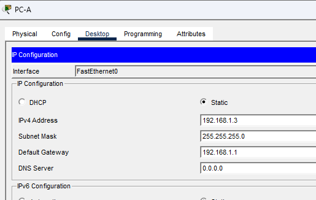
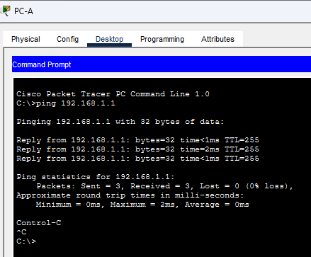
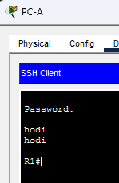
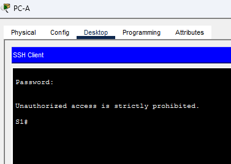
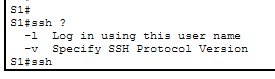
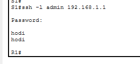

# Лабораторная работа. Доступ к сетевым устройствам по протоколу SSH

## Топология
 

## Таблица адресации
|Устройство	|Интерфейс	|IP-адрес	|Маска подсети	|Шлюз по умолчанию|
|-|-|-|-|-|
|R1	|G0/0/1	|192.168.1.1	|255.255.255.0	|—|
|S1	|VLAN 1	|192.168.1.11	|255.255.255.0	|192.168.1.1|
|PC-A	|NIC	|192.168.1.3	|255.255.255.0	|192.168.1.1|
## Задачи
 Часть 1. Настройка основных параметров устройства

 Часть 2. Настройка маршрутизатора для доступа по протоколу SSH

 Часть 3. Настройка коммутатора для доступа по протоколу SSH

 Часть 4. SSH через интерфейс командной строки (CLI) коммутатора

## Общие сведения/сценарий
Раньше для удаленной настройки сетевых устройств в основном применялся протокол Telnet. Однако он не обеспечивает шифрование информации, передаваемой между клиентом и сервером, что позволяет анализаторам сетевых пакетов перехватывать пароли и данные конфигурации.

Secure Shell (SSH) — это сетевой протокол, устанавливающий безопасное подключение с эмуляцией терминала к маршрутизатору или иному сетевому устройству. Протокол SSH шифрует все сведения, которые поступают по сетевому каналу, и предусматривает аутентификацию удаленного компьютера. Протокол SSH все больше заменяет Telnet — именно его выбирают сетевые специалисты в качестве средства удаленного входа в систему. SSH чаще всего используется для входа на удаленное устройство и выполнения команд. Но это может также передавать файлы по связанным протоколам SFTP или SCP.

Чтобы протокол SSH мог работать, на сетевых устройствах, взаимодействующих между собой, должна быть настроена поддержка SSH. В этой лабораторной работе необходимо включить SSH-сервер на маршрутизаторе, после чего подключиться к этому маршрутизатору, используя ПК с установленным клиентом SSH. В локальной сети подключение обычно устанавливается с помощью Ethernet и IP.

Примечание: Маршрутизаторы, используемые в практических лабораторных работах CCNA, - это Cisco 4221 с Cisco IOS XE Release 16.9.4 (образ universalk9). В лабораторных работах используются коммутаторы Cisco Catalyst 2960 с Cisco IOS версии 15.2(2) (образ lanbasek9). Можно использовать другие маршрутизаторы, коммутаторы и версии Cisco IOS. В зависимости от модели устройства и версии Cisco IOS доступные команды и результаты их выполнения могут отличаться от тех, которые показаны в лабораторных работах. Правильные идентификаторы интерфейса см. в сводной таблице по интерфейсам маршрутизаторов в конце лабораторной работы.

Примечание:  Убедитесь, что у всех маршрутизаторов и коммутаторов была удалена начальная конфигурация. Если вы не уверены, обратитесь к инструктору.

## Необходимые ресурсы
- 1 Маршрутизатор (Cisco 4221 с универсальным образом Cisco IOS XE версии 16.9.4 или аналогичным)

- 1 коммутатор (Cisco 2960 с ПО Cisco IOS версии 15.2(2) с образом lanbasek9 или аналогичная модель)
- 1 ПК (под управлением Windows с программой эмуляции терминала, например, Tera Term)
- Консольные кабели для настройки устройств Cisco IOS через консольные порты.
- Кабели Ethernet, расположенные в соответствии с топологией

## Инструкции

### Часть 1. Настройка основных параметров устройств
В части 1 потребуется настроить топологию сети и основные параметры, такие как IP-адреса интерфейсов, доступ к устройствам и пароли на маршрутизаторе.

#### Шаг 1. Создайте сеть согласно топологии.
#### Шаг 2. Выполните инициализацию и перезагрузку маршрутизатора и коммутатора.
#### Шаг 3. Настройте маршрутизатор.

Откройте окно конфигурации

a.	Подключитесь к маршрутизатору с помощью консоли и активируйте привилегированный режим EXEC.

b.	Войдите в режим конфигурации.

c.	Отключите поиск DNS, чтобы предотвратить попытки маршрутизатора неверно преобразовывать введенные команды таким образом, как будто они являются именами узлов.

d.	Назначьте class в качестве зашифрованного пароля привилегированного режима EXEC.

e.	Назначьте cisco в качестве пароля консоли и включите вход в систему по паролю.

f.	Назначьте cisco в качестве пароля VTY и включите вход в систему по паролю.

g.	Зашифруйте открытые пароли.

h.	Создайте баннер, который предупреждает о запрете несанкционированного доступа.

i.	Настройте и активируйте на маршрутизаторе интерфейс G0/0/1, используя информацию, приведенную в таблице адресации.

j.	Сохраните текущую конфигурацию в файл загрузочной конфигурации.

```
Router>
Router>enable
Router#conf t
Enter configuration commands, one per line.  End with CNTL/Z.
Router(config)#no ip dom
Router(config)#no ip domain
Router(config)#no ip domain-l
Router(config)#no ip domain-lookup 
Router(config)#hostname R1
R1(config)#enable
R1(config)#enable secret class
R1(config)#servic
R1(config)#service pass
R1(config)#service password-encryption 
R1(config)#line con 0
R1(config-line)#password cisco
R1(config-line)#login
R1(config-line)#loggi
R1(config-line)#logging syn
R1(config-line)#logging synchronous 
R1(config-line)#exit
R1(config)#line vty 0 4
R1(config-line)#password cisco
R1(config-line)#login
R1(config-line)#exit
R1(config)#banner
R1(config)#banner mo
R1(config)#banner motd Uhodi
Enter TEXT message.  End with the character 'U'.
hodi U

R1(config)#int g0/0/1
R1(config-if)#ip addres
R1(config-if)#ip address 192.168.1.1 255.255.255.0
R1(config-if)#no shutdown

R1(config-if)#
%LINK-5-CHANGED: Interface GigabitEthernet0/0/1, changed state to up

%LINEPROTO-5-UPDOWN: Line protocol on Interface GigabitEthernet0/0/1, changed state to up

R1(config-if)#exit
R1(config)#exit
R1#
%SYS-5-CONFIG_I: Configured from console by console

R1#copy cur
R1#copy run st
R1#copy run startup-config 
Destination filename [startup-config]? y
%Error copying nvram:y (Invalid argument)
R1#copy run star
Destination filename [startup-config]? 
Building configuration...
[OK]
R1#
```

#### Шаг 4. Настройте компьютер PC-A.

a.	Настройте для PC-A IP-адрес и маску подсети.

b.	Настройте для PC-A шлюз по умолчанию.



#### Шаг 5. Проверьте подключение к сети.

Пошлите с PC-A команду Ping на маршрутизатор R1. Если эхо-запрос с помощью команды ping не проходит, найдите и устраните неполадки подключения.



Закройте окно настройки.

### Часть 2. Настройка маршрутизатора для доступа по протоколу SSH

Подключение к сетевым устройствам по протоколу Telnet сопряжено с риском для безопасности, поскольку вся информация передается в виде открытого текста. Протокол SSH шифрует данные сеанса и обеспечивает аутентификацию устройств, поэтому для удаленных подключений рекомендуется использовать именно этот протокол. В части 2 вам нужно настроить маршрутизатор для приема соединений SSH по линиям VTY.

#### Шаг 1. Настройте аутентификацию устройств.

При генерации ключа шифрования в качестве его части используются имя устройства и домен. Поэтому эти имена необходимо указать перед вводом команды crypto key.
Откройте окно конфигурации

a.	Задайте имя устройства.

b.	Задайте домен для устройства.

```
R1(config)#ip domain-name home.local
```
#### Шаг 2. Создайте ключ шифрования с указанием его длины.
```
R1(config)#crypto key generate rsa
The name for the keys will be: R1.home.local
Choose the size of the key modulus in the range of 360 to 4096 for your
  General Purpose Keys. Choosing a key modulus greater than 512 may take
  a few minutes.

How many bits in the modulus [512]: 1024
% Generating 1024 bit RSA keys, keys will be non-exportable...[OK]

R1(config)#
```
#### Шаг 3. Создайте имя пользователя в локальной базе учетных записей.

Настройте имя пользователя, используя admin в качестве имени пользователя и Adm1nP@55 в качестве пароля.
```
R1(config)#username admin privilege 15 secret Adm1nP@55
```

#### Шаг 4. Активируйте протокол SSH на линиях VTY.

a.	Активируйте протоколы Telnet и SSH на входящих линиях VTY с помощью команды transport input.

b.	Измените способ входа в систему таким образом, чтобы использовалась проверка пользователей по локальной базе учетных записей.

```
R1(config)#line vty 0 4
R1(config-line)#transport input all
R1(config-line)#login local
R1(config-line)#exit
```

#### Шаг 5. Сохраните текущую конфигурацию в файл загрузочной конфигурации.
```
R1#copy run start
Destination filename [startup-config]? 
Building configuration...
[OK]
R1#
```

#### Шаг 6. Установите соединение с маршрутизатором по протоколу SSH.

a.	Запустите Tera Term с PC-A.

b.	Установите SSH-подключение к R1. Use the username admin and password Adm1nP@55. У вас должно получиться установить SSH-подключение к R1.


Закройте окно настройки.
### Часть 3. Настройка коммутатора для доступа по протоколу SSH

В части 3 вам предстоит настроить коммутатор для приема подключений по протоколу SSH, а затем установить SSH-подключение с помощью программы Tera Term.
####  Шаг 1. Настройте основные параметры коммутатора.

Откройте окно конфигурации

a.	Подключитесь к коммутатору с помощью консольного подключения и активируйте привилегированный режим EXEC.

b.	Войдите в режим конфигурации.

c.	Отключите поиск DNS, чтобы предотвратить попытки маршрутизатора неверно преобразовывать введенные команды таким образом, как будто они являются именами узлов.

d.	Назначьте class в качестве зашифрованного пароля привилегированного режима EXEC.

e.	Назначьте cisco в качестве пароля консоли и включите вход в систему по паролю.

f.	Назначьте cisco в качестве пароля VTY и включите вход в систему по паролю.

g.	Зашифруйте открытые пароли.

h.	Создайте баннер, который предупреждает о запрете несанкционированного доступа.

i.	Настройте и активируйте на коммутаторе интерфейс VLAN 1, используя информацию, приведенную в таблице адресации.

j.	Сохраните текущую конфигурацию в файл загрузочной конфигурации.
```
Switch>en
Switch#conf t
Enter configuration commands, one per line.  End with CNTL/Z.
Switch(config)#no ip doma
Switch(config)#no ip domain
Switch(config)#no ip domain-lookup
Switch(config)#hostname S1
S1(config)#enable sec
S1(config)#enable secret class
S1(config)#line con 0
S1(config-line)#password cisco
S1(config-line)#login
S1(config-line)#loggin
S1(config-line)#logging sy
S1(config-line)#logging synchronous 
S1(config-line)#exit
S1(config)#line vty 0 4
S1(config-line)#password cisco
S1(config-line)#login
S1(config-line)#exit
S1(config)#banner motd #
Enter TEXT message.  End with the character '#'.
Unauthorized access is strictly prohibited.#

S1(config)#inet
S1(config)#inte
S1(config)#interface vlan 1
S1(config-if)#ip addre
S1(config-if)#ip address 192.168.1.11 255.255.255.0
S1(config-if)#no shutdown

S1(config-if)#

S1(config-if)#exit
S1(config)#ip default gate
S1(config)#ip defaul
S1(config)#ip default-gateway 192.168.1.1
S1(config)#end
S1#
%SYS-5-CONFIG_I: Configured from console by console

S1#copy run start
Destination filename [startup-config]? 
Building configuration...
[OK]
S1#
```
#### Шаг 2. Настройте коммутатор для соединения по протоколу SSH.

Для настройки протокола SSH на коммутаторе используйте те же команды, которые применялись для аналогичной настройки маршрутизатора в части 2.

a.	Настройте имя устройства, как указано в таблице адресации.

b.	Задайте домен для устройства.

c.	Создайте ключ шифрования с указанием его длины.

d.	Создайте имя пользователя в локальной базе учетных записей.

e.	Активируйте протоколы Telnet и SSH на линиях VTY.

f.	Измените способ входа в систему таким образом, чтобы использовалась проверка пользователей по локальной базе учетных записей.
```
S1#conf t
Enter configuration commands, one per line.  End with CNTL/Z.
S1(config)#ip doma
S1(config)#ip domai
S1(config)#ip domain
S1(config)#ip domain
S1(config)#ip domain-
S1(config)#ip domain-n
S1(config)#ip domain-name home.local
S1(config)#cryp
S1(config)#crypto key gene
S1(config)#crypto key generate rsa
The name for the keys will be: S1.home.local
Choose the size of the key modulus in the range of 360 to 4096 for your
  General Purpose Keys. Choosing a key modulus greater than 512 may take
  a few minutes.

How many bits in the modulus [512]: 1024
% Generating 1024 bit RSA keys, keys will be non-exportable...[OK]

S1(config)#username admin privi
*Mar 1 0:25:26.618: %SSH-5-ENABLED: SSH 1.99 has been enabled
S1(config)#username admin privilege 15 secret Adm1nP@55
S1(config)#line vty 0 4
S1(config-line)#transp
S1(config-line)#transport inp
S1(config-line)#transport input all
S1(config-line)#login local
S1(config-line)#exit
S1(config)#
```
#### Шаг 3. Установите соединение с коммутатором по протоколу SSH.

Запустите программу Tera Term на PC-A, затем установите подключение по протоколу SSH к интерфейсу SVI коммутатора S1.



**Вопрос**:
Удалось ли вам установить SSH-соединение с коммутатором?

**Ответ**: Да

Закройте окно настройки.

### Часть 4. Настройка протокола SSH с использованием интерфейса командной строки (CLI) коммутатора

Клиент SSH встроен в операционную систему Cisco IOS и может запускаться из интерфейса командной строки. В части 4 вам предстоит установить соединение с маршрутизатором по протоколу SSH, используя интерфейс командной строки коммутатора.

#### Шаг 1. Посмотрите доступные параметры для клиента SSH в Cisco IOS.

Откройте окно конфигурации

Используйте вопросительный знак (?), чтобы отобразить варианты параметров для команды ssh.
```
S1# ssh? 
  -c Select encryption algorithm
  -l Log in using this user name
  -m Select HMAC algorithm
  -o Specify options
  -p Connect to this port
  -v Specify SSH Protocol Version
  -vrf Specify vrf name
  WORD IP-адрес или имя хоста удаленной системы
```



### Шаг 2. Установите с коммутатора S1 соединение с маршрутизатором R1 по протоколу SSH.

a.	Чтобы подключиться к маршрутизатору R1 по протоколу SSH, введите команду –l admin. Это позволит вам войти в систему под именем admin. При появлении приглашения введите в качестве пароля Adm1nP@55
```
S1# ssh -l admin 192.168.1.1
Password: 
Authorized Users Only!
R1>
```
b.	Чтобы вернуться к коммутатору S1, не закрывая сеанс SSH с маршрутизатором R1, нажмите комбинацию клавиш Ctrl+Shift+6. Отпустите клавиши Ctrl+Shift+6 и нажмите x. Отображается приглашение привилегированного режима EXEC коммутатора.
```
R1>
S1#
```

c.	Чтобы вернуться к сеансу SSH на R1, нажмите клавишу Enter в пустой строке интерфейса командной строки. Чтобы увидеть окно командной строки маршрутизатора, нажмите клавишу Enter еще раз.
```
S1#
[Resuming connection 1 to 192.168.1.1 ... ]

R1>
```


d.	Чтобы завершить сеанс SSH на маршрутизаторе R1, введите в командной строке маршрутизатора команду exit.
```
R1# exit

[Connection to 192.168.1.1 closed by foreign host]
S1#
```
**Вопрос:**
Какие версии протокола SSH поддерживаются при использовании интерфейса командной строки?

**Ответ:** Cisco IOS поддерживает SSHv1 и SSHv2. По умолчанию, если ключ сгенерирован с модулем 1024 бита и больше, используется SSHv2 (SSHv1 считается устаревшим и небезопасным). 

Закройте окно настройки.
## Вопрос для повторения
Как предоставить доступ к сетевому устройству нескольким пользователям, у каждого из которых есть собственное имя пользователя?

**Ответ** Нужно создать в локальной базе устройства отдельную учётную запись для каждого пользователя и переключить линии VTY на аутентификацию по локальной базе. При этом для каждого пользователя могут быть назначены разные уровни доступ от 1 до 15


### Сводная таблица по интерфейсам маршрутизаторов
|Модель маршрутизатора|Интерфейс Ethernet № 1|Интерфейс Ethernet № 2|Последовательный интерфейс № 1|Последовательный интерфейс № 2|
|-|-|-|-|-|
|1 800|Fast Ethernet 0/0 (F0/0)|Fast Ethernet 0/1 (F0/1)|Serial 0/0/0 (S0/0/0)|Serial 0/0/1 (S0/0/1)|
|1900	|Gigabit Ethernet 0/0 (G0/0)	|Gigabit Ethernet 0/1 (G0/1)	|Serial 0/0/0 (S0/0/0)	|Serial 0/0/1 (S0/0/1)|
|2801	|Fast Ethernet 0/0 (F0/0)	|Fast Ethernet 0/1 (F0/1)	|Serial 0/1/0 (S0/1/0)	|Serial 0/1/1 (S0/1/1)|
|2811	|Fast Ethernet 0/0 (F0/0)	|Fast Ethernet 0/1 (F0/1)	|Serial 0/0/0 (S0/0/0)	|Serial 0/0/1 (S0/0/1)|
|2900	|Gigabit Ethernet 0/0 (G0/0)	|Gigabit Ethernet 0/1 (G0/1)	|Serial 0/0/0 (S0/0/0)	|Serial 0/0/1 (S0/0/1)|
|4221	|Gigabit Ethernet 0/0/0 (G0/0/0)	|Gigabit Ethernet 0/0/1 (G0/0/1)	|Serial 0/1/0 (S0/1/0)	|Serial 0/1/1 (S0/1/1)|
|4300	|Gigabit Ethernet 0/0/0 (G0/0/0)	|Gigabit Ethernet 0/0/1 (G0/0/1)	|Serial 0/1/0 (S0/1/0)	|Serial 0/1/1 (S0/1/1)|

**Примечание**. Чтобы определить конфигурацию маршрутизатора, можно посмотреть на интерфейсы и установить тип маршрутизатора и количество его интерфейсов. Перечислить все комбинации конфигураций для каждого класса маршрутизаторов невозможно. Эта таблица содержит идентификаторы для возможных комбинаций интерфейсов Ethernet и последовательных интерфейсов на устройстве. Другие типы интерфейсов в таблице не представлены, хотя они могут присутствовать в данном конкретном маршрутизаторе. В качестве примера можно привести интерфейс ISDN BRI. Строка в скобках — это официальное сокращение, которое можно использовать в командах Cisco IOS для обозначения интерфейса.

## Ход выполнения стандарнтной настройки

```
enable - вход в привелигированный режим
conf t - вход в режим глобальной конфигурации
no ip domain-lookup - отключение DNS-поиска
hostname S1 - меняет имя коммутатора
service password-encryption - включает слабое шифрование (type7)
enable secret class - устанавливает пароль class для входа в привилегированный режим
banner motd # - задает сообщение при входе и символ, до которого будет считываться банер
Unauthorized access is strictly prohibited. # - сообщение и закрывающий банер символ
line con 0 - вход в настройки консольной линии (физический порт Console)
password cisco - пароль для входа в консоль
logging synchronous - отключение логов (не пишутся системные логи в окно консоли, для удобства. Например Interface G0/1 UP)
password cisco
login - обязательная команда: без неё пароль не будет запрашиваться, и устройство пустит без аутентификации
exit 0 выход в меню выше
#настройка telnet/ssh
line vty 0 4 - виртуальные линии для удалённых подключений
password cisco - пароль для входа по Telnet/SSH
login - обязательная команда: без неё пароль не будет запрашиваться, и устройство пустит без аутентификации
exit
#Настройка SVI VLAN 1 — интерфейса управления
interface vlan 1 - виртуальный интерфейс (SVI) для управления коммутатором
ip address 192.168.1.2 255.255.255.0 - присваивает IPv4-адрес и маску
no shutdown - обязательно, по умолчанию SVI выключен и не поднимается, даже если физические порты активны
end - выход из режима конфигурации в привилегированный
###Настройка завершена

### Сейчас настроен только Telnet (по умолчанию). Для SSH нужно ещё:
ip domain-name example.com
crypto key generate rsa modulus 1024
ip ssh version 2
line vty 0 4
transport input ssh
username admin privilege 15 secret <пароль>
```
Кратко скрипт:
```
enable
conf t
no ip domain-lookup
hostname S1
service password-encryption
enable secret class
banner motd #
Unauthorized access is strictly prohibited. #
line con 0
password cisco
login
logging synchronous 
exit
line vty 0 4
password cisco
login
exit
interface vlan 1
ip address 192.168.1.2 255.255.255.0
no shutdown
end
```