# Лабораторная работа - Внедрение маршрутизации между виртуальными локальными сетями 

## Топология
 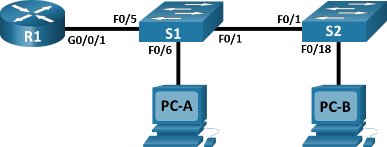
## Таблица адресации
|Устройство	|Интерфейс	|IP-адрес	|Маска подсети	|Шлюз по умолчанию|
|-|-|-|-|-|
|R1	|G0/0/1.10	|192.168.10.1	|255.255.255.0	|—|
|R1	|G0/0/1.20	|192.168.20.1	|255.255.255.0	|—|
|R1	|G0/0/1.30	|192.168.30.1	|255.255.255.0	|—|
|R1	|G0/0/1.1000	|—	|—	|—|
|S1	|VLAN 10	|192.168.10.11	|255.255.255.0	|192.168.10.1|
|S2	|VLAN 10	|192.168.10.12	|255.255.255.0	|192.168.10.1|
|PC-A	|NIC	|192.168.20.3	|255.255.255.0	|192.168.20.1|
|PC-B	|NIC	|192.168.30.3	|255.255.255.0	|192.168.30.1|

## Таблица VLAN

|VLAN	|Имя	|Назначенный интерфейс|
|-|-|-|
|10	|Управление	|S1: VLAN 10; S2: VLAN 10 |
|20	|Sales	|S1: F0/6|
|30	|Operations	|S2: F0/18|
|999	|Parking_Lot	|С1: F0/2-4, F0/7-24, G0/1-2; С2: F0/2-17, F0/19-24, G0/1-2|
|1000	|Собственная	|—|

## Задачи
- Часть 1. Создание сети и настройка основных параметров устройства
- Часть 2. Создание сетей VLAN и назначение портов коммутатора
- Часть 3. Настройка транка 802.1Q между коммутаторами.
- Часть 4. Настройка маршрутизации между сетями VLAN
- Часть 5. Проверка, что маршрутизация между VLAN работает
## Общие сведения/сценарий
В целях повышения производительности сети большие широковещательные домены 2-го уровня делят на домены меньшего размера. Для этого современные коммутаторы используют виртуальные локальные сети (VLAN). VLAN также можно использовать в качестве меры безопасности, отделяя конфиденциальный трафик данных от остальной части сети. Сети VLAN облегчают процесс проектирования сети, обеспечивающей помощь в достижении целей организации. Для связи между VLAN требуется устройство, работающее на уровне 3 модели OSI. Добавление маршрутизации между VLAN позволяет организации разделять и разделять широковещательные домены, одновременно позволяя им обмениваться данными друг с другом.

Транковые каналы сети VLAN используются для распространения сетей VLAN по различным устройствам. Транковые каналы разрешают передачу трафика из множества сетей VLAN через один канал, не нанося вред идентификации и сегментации сети VLAN. Особый вид маршрутизации между VLAN, называемый «Router-on-a-Stick», использует магистраль от маршрутизатора к коммутатору, чтобы все VLAN могли переходить к маршрутизатору.

В этой лабораторной работе вы создадите VLAN на обоих коммутаторах в топологии, назначите VLAN для коммутации портов доступа, убедитесь, что VLAN работают должным образом, создадите транки VLAN между двумя коммутаторами и между S1 и R1, и настройте маршрутизацию между VLAN на R1 для разрешения связи между хостами в разных VLAN независимо от подсети, в которой находится хост.

Примечание: Маршрутизаторы, используемые в практических лабораторных работах CCNA, - это Cisco 4221 с Cisco IOS XE Release 16.9.4 (образ universalk9). В лабораторных работах используются коммутаторы Cisco Catalyst 2960 с Cisco IOS версии 15.2(2) (образ lanbasek9). Можно использовать другие маршрутизаторы, коммутаторы и версии Cisco IOS. В зависимости от модели устройства и версии Cisco IOS доступные команды и результаты их выполнения могут отличаться от тех, которые показаны в лабораторных работах. Правильные идентификаторы интерфейса см. в сводной таблице по интерфейсам маршрутизаторов в конце лабораторной работы.

Примечание. Убедитесь, что у всех маршрутизаторов и коммутаторов была удалена начальная конфигурация. Если вы не уверены в этом, обратитесь к инструктору.

## Необходимые ресурсы
- 1 Маршрутизатор (Cisco 4221 с универсальным образом Cisco IOS XE версии 16.9.4 или аналогичным)
- 2 коммутатора (Cisco 2960 с операционной системой Cisco IOS 15.2(2) (образ lanbasek9) или аналогичная модель)
- 2 ПК (ОС Windows с программой эмуляции терминалов, такой как Tera Term)
- Консольные кабели для настройки устройств Cisco IOS через консольные порты.
- Кабели Ethernet, расположенные в соответствии с топологией
## Инструкции

### Часть 1. Создание сети и настройка основных параметров устройства
В первой части лабораторной работы вам предстоит создать топологию сети и настроить базовые параметры для узлов ПК и коммутаторов.
#### Шаг 1. Создайте сеть согласно топологии.
Подключите устройства, как показано в топологии, и подсоедините необходимые кабели.
#### Шаг 2. Настройте базовые параметры для маршрутизатора.

a.	Подключитесь к маршрутизатору с помощью консоли и активируйте привилегированный режим EXEC.
Откройте окно конфигурации

b.	Войдите в режим конфигурации.

c.	Назначьте маршрутизатору имя устройства.

d.	Отключите поиск DNS, чтобы предотвратить попытки маршрутизатора неверно преобразовывать введенные команды таким образом, как будто они являются именами узлов.

e.	Назначьте class в качестве зашифрованного пароля привилегированного режима EXEC.

f.	Назначьте cisco в качестве пароля консоли и включите вход в систему по паролю.

g.	Установите cisco в качестве пароля виртуального терминала и активируйте вход.

h.	Зашифруйте открытые пароли.

i.	Создайте баннер с предупреждением о запрете несанкционированного доступа к устройству.

j.	Сохраните текущую конфигурацию в файл загрузочной конфигурации.

k.	Настройте на маршрутизаторе время.
Закройте окно настройки.

```
Router>enable
Router#conf t
Enter configuration commands, one per line.  End with CNTL/Z.
Router(config)#hostname R1
R1(config)#no ip domain-lo
R1(config)#no ip domain-lookup 
R1(config)#enable secret class
R1(config)#service pass
R1(config)#service password-encryption 
R1(config)#banner m
R1(config)#banner motd #
Enter TEXT message.  End with the character '#'.
Uhodi#

R1(config)#line con 0
R1(config-line)#password cisco
R1(config-line)#login
R1(config-line)#loggi
R1(config-line)#logging sy
R1(config-line)#logging synchronous 
R1(config-line)#exit
R1(config)#line vty 0 4
R1(config-line)#password cisco
R1(config-line)#login
R1(config-line)#ip domain-name home.local
R1(config)#crypto key gene
R1(config)#crypto key generate rsa modul
R1(config)#crypto key generate rsa m
R1(config)#crypto key generate rsa m
R1(config)#crypto key generate rsa m
R1(config)#crypto key generate rsa
The name for the keys will be: R1.home.local
Choose the size of the key modulus in the range of 360 to 4096 for your
  General Purpose Keys. Choosing a key modulus greater than 512 may take
  a few minutes.

How many bits in the modulus [512]: 1024
% Generating 1024 bit RSA keys, keys will be non-exportable...[OK]

R1(config)#line vty 0 4
*Mar 1 0:5:2.893: %SSH-5-ENABLED: SSH 1.99 has been enabled
R1(config-line)#trans
R1(config-line)#transport input all
R1(config-line)#username admin privi
R1(config-line)#username admin priv
R1(config-line)#username admin priv
R1(config-line)#username admin privile
R1(config-line)#username admin privile
R1(config-line)#username admin privile
R1(config-line)#username admin ?
% Unrecognized command
R1(config-line)#username ?
% Unrecognized command
R1(config-line)#usern
R1(config-line)#exit
R1(config)#usernm
R1(config)#usern
R1(config)#username adm
R1(config)#username admin pri
R1(config)#username admin privilege 15 secr
R1(config)#username admin privilege 15 secret Adm1nP@55
R1(config)#clock set 18:39:00 11 Oct 2026
                 ^
% Invalid input detected at '^' marker.
	
R1(config)#clock ?
  timezone  Configure time zone
R1(config)#clock 18:39:00 11 Oct 2026
                 ^
% Invalid input detected at '^' marker.
	
R1(config)#clock 
% Incomplete command.
R1(config)#clo
R1(config)#clock ?
  timezone  Configure time zone
R1(config)#clock tim
R1(config)#clock timezone MSK 3
R1(config)#time
            ^
% Invalid input detected at '^' marker.
	
R1(config)#da
R1(config)#da?
% Unrecognized command
R1(config)#da
R1(config)#dat
R1(config)#data
R1(config)#date
            ^
% Invalid input detected at '^' marker.
	
R1(config)#end
R1#
%SYS-5-CONFIG_I: Configured from console by console

R1#clock
% Incomplete command.
R1#clock 18:39:00 11 Oct 2026
         ^
% Invalid input detected at '^' marker.
	
R1#clock set 18:39:00 11 Oct 2026
R1#clock update-calendar
         ^
% Invalid input detected at '^' marker.
	
R1#conf t
Enter configuration commands, one per line.  End with CNTL/Z.
R1(config)#clock update-calendar
                 ^
% Invalid input detected at '^' marker.
	
R1(config)#clock up
R1(config)#clock upda
R1(config)#clock upd
R1(config)#clock upd
R1(config)#clock upd
R1(config)#clock ?
  timezone  Configure time zone
R1(config)#exit
R1#
%SYS-5-CONFIG_I: Configured from console by console

R1#clock ?
  set  Set the time and date
R1#
R1#
R1#
R1#copy run start
Destination filename [startup-config]? 
Building configuration...
[OK]
R1#
```
#### Шаг 3. Настройте базовые параметры каждого коммутатора.

a.	Присвойте коммутатору имя устройства.

b.	Отключите поиск DNS, чтобы предотвратить попытки маршрутизатора неверно преобразовывать введенные команды таким образом, как будто они являются именами узлов.

c.	Назначьте class в качестве зашифрованного пароля привилегированного режима EXEC.

d.	Назначьте cisco в качестве пароля консоли и включите вход в систему по паролю.

e.	Установите cisco в качестве пароля виртуального терминала и активируйте вход.

f.	Зашифруйте открытые пароли.

g.	Создайте баннер с предупреждением о запрете несанкционированного доступа к устройству.

h.	Настройте на коммутаторах время.

i.	Сохранение текущей конфигурации в качестве начальной.
```
Switch>enable
Switch#conf t
Enter configuration commands, one per line.  End with CNTL/Z.
Switch(config)#no ip domain-lo
Switch(config)#no ip domain-lookup 
Switch(config)#hostname S1
S1(config)#clock timezone MSK 3
S1(config)#service password-en
S1(config)#service password-encryption 
S1(config)#enable secret class
S1(config)#ip domain-name home.local
S1(config)#crypto key generate rsa
The name for the keys will be: S1.home.local
Choose the size of the key modulus in the range of 360 to 4096 for your
  General Purpose Keys. Choosing a key modulus greater than 512 may take
  a few minutes.

How many bits in the modulus [512]: 1024
% Generating 1024 bit RSA keys, keys will be non-exportable...[OK]

S1(config)#username admin provi
*Mar 1 3:14:32.343: %SSH-5-ENABLED: SSH 1.99 has been enabled
S1(config)#username admin provil
S1(config)#username admin provil
S1(config)#ban
S1(config)#banner modt #
                    ^
% Invalid input detected at '^' marker.
	
S1(config)#UhodiS1#
            ^
% Invalid input detected at '^' marker.
	
S1(config)#banner motd #
Enter TEXT message.  End with the character '#'.
UhodiS1#

S1(config)#line con 0
S1(config-line)#password cisco
S1(config-line)#login
S1(config-line)#loggi
S1(config-line)#logging sy
S1(config-line)#logging synchronous 
S1(config-line)#exit
S1(config)#line vty 0 4
S1(config-line)#password cisco
S1(config-line)#login
S1(config-line)#transp
S1(config-line)#transport input all
S1(config-line)#usernma
S1(config-line)#usern
S1(config-line)#user
S1(config-line)#user
S1(config-line)#usernam
S1(config-line)#usernam
S1(config-line)#username a
S1(config-line)#username
S1(config-line)#exit
S1(config)#clock set 18:39:00 11 Oct 2026
                 ^
% Invalid input detected at '^' marker.
	
S1(config)#exit
S1#
%SYS-5-CONFIG_I: Configured from console by console

S1#clock set 18:39:00 11 Oct 2026
S1#copy run start
Destination filename [startup-config]? 
Building configuration...
[OK]
S1#
?Bad filename
%Error parsing filename (Bad file number)
S1#clock set 18:54:00 11 Oct 2026
S1#
```
```
Switch>enbale 
Translating "enbale"...domain server (255.255.255.255) % Name lookup aborted
Switch>enab
Switch>enable 
Switch#conf t
Enter configuration commands, one per line.  End with CNTL/Z.
Switch(config)#no ip domain-lookup
Switch(config)#hostname S2
S2(config)#clock timezone MSK 3
S2(config)#service password-encr
S2(config)#service password-encryption 
S2(config)#enable secret class
S2(config)#ip domain-name home.local
S2(config)#crypto key gene
S2(config)#crypto key generate rsa
The name for the keys will be: S2.home.local
Choose the size of the key modulus in the range of 360 to 4096 for your
  General Purpose Keys. Choosing a key modulus greater than 512 may take
  a few minutes.

How many bits in the modulus [512]: 1024
% Generating 1024 bit RSA keys, keys will be non-exportable...[OK]

S2(config)#banner mo
*Mar 1 3:20:28.154: %SSH-5-ENABLED: SSH 1.99 has been enabled
S2(config)#banner motd #
Enter TEXT message.  End with the character '#'.
UhosiS2#

S2(config)#lino con 0
              ^
% Invalid input detected at '^' marker.
	
S2(config)#line con 0
S2(config-line)#password cisco
S2(config-line)#ligin
                 ^
% Invalid input detected at '^' marker.
	
S2(config-line)#exit
S2(config)#line vty 0 4
S2(config-line)#password cisco
S2(config-line)#login
S2(config-line)#transprot input all
                      ^
% Invalid input detected at '^' marker.
	
S2(config-line)#transport input all
S2(config-line)#exit
S2(config)#clock set 18:53:00 11 Oct 2026
                 ^
% Invalid input detected at '^' marker.
	
S2(config)#clock set 18:53:00 11 Oct 2026
S2#
%SYS-5-CONFIG_I: Configured from console by console

S2#clock set 18:39:00 11 Oct 2026
S2#
S2#clock set 18:54:00 11 Oct 2026
S2#
```
Закройте окно настройки.
#### Шаг 4. Настройте узлы ПК.

Адреса ПК можно посмотреть в таблице адресации.
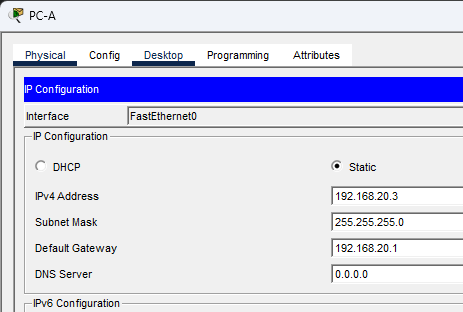

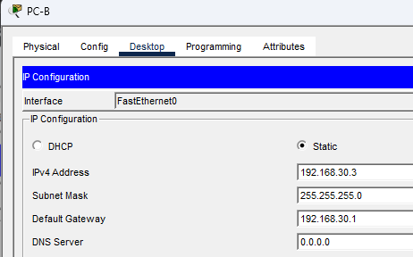

### Часть 2. Создание сетей VLAN и назначение портов коммутатора

Во второй части вы создадите VLAN, как указано в таблице выше, на обоих коммутаторах. Затем вы назначите VLAN соответствующему интерфейсу и проверите настройки конфигурации. Выполните следующие задачи на каждом коммутаторе.
#### Шаг 1. Создайте сети VLAN на коммутаторах.

a.	Создайте и назовите необходимые VLAN на каждом коммутаторе из таблицы выше.

Откройте окно конфигурации
```
S1#conf t
Enter configuration commands, one per line.  End with CNTL/Z.
S1(config)#vlan 10
S1(config-vlan)#name Upravlenie
S1(config-vlan)#exit
S1(config)#vlan 20
S1(config-vlan)#name Sales
S1(config-vlan)#vlan 30
S1(config-vlan)#name Operations
S1(config-vlan)#vlan 999
S1(config-vlan)#name Parking_Lot
S1(config-vlan)#vlan 1000
S1(config-vlan)#name Native
S1(config-vlan)#
```
b.	Настройте интерфейс управления и шлюз по умолчанию на каждом коммутаторе, используя информацию об IP-адресе в таблице адресации. 
```
S2(config)#interface vlan 10
S2(config-if)#
%LINK-5-CHANGED: Interface Vlan10, changed state to up
ip address 192.168.10.12 255.255.255.0
S2(config-if)#no shutdown
S2(config-if)#exit
S2(config)#ip default-gateway 192.168.10.1
S2(config)#
```
c.	Назначьте все неиспользуемые порты коммутатора VLAN Parking_Lot, настройте их для статического режима доступа и административно деактивируйте их.
```
S2(config)#interface range f0/2-17, f0/19-24, g0/1-2
S2(config-if-range)#switchport mode access
S2(config-if-range)#switchport access vlan 999
S2(config-if-range)#shutdown

%LINK-5-CHANGED: Interface FastEthernet0/2, changed state to administratively down

%LINK-5-CHANGED: Interface FastEthernet0/3, changed state to administratively down

%LINK-5-CHANGED: Interface FastEthernet0/4, changed state to administratively down

%LINK-5-CHANGED: Interface FastEthernet0/5, changed state to administratively down

%LINK-5-CHANGED: Interface FastEthernet0/6, changed state to administratively down

%LINK-5-CHANGED: Interface FastEthernet0/7, changed state to administratively down

%LINK-5-CHANGED: Interface FastEthernet0/8, changed state to administratively down

%LINK-5-CHANGED: Interface FastEthernet0/9, changed state to administratively down

%LINK-5-CHANGED: Interface FastEthernet0/10, changed state to administratively down

%LINK-5-CHANGED: Interface FastEthernet0/11, changed state to administratively down

%LINK-5-CHANGED: Interface FastEthernet0/12, changed state to administratively down

%LINK-5-CHANGED: Interface FastEthernet0/13, changed state to administratively down

%LINK-5-CHANGED: Interface FastEthernet0/14, changed state to administratively down

%LINK-5-CHANGED: Interface FastEthernet0/15, changed state to administratively down

%LINK-5-CHANGED: Interface FastEthernet0/16, changed state to administratively down

%LINK-5-CHANGED: Interface FastEthernet0/17, changed state to administratively down

%LINK-5-CHANGED: Interface FastEthernet0/19, changed state to administratively down

%LINK-5-CHANGED: Interface FastEthernet0/20, changed state to administratively down

%LINK-5-CHANGED: Interface FastEthernet0/21, changed state to administratively down

%LINK-5-CHANGED: Interface FastEthernet0/22, changed state to administratively down

%LINK-5-CHANGED: Interface FastEthernet0/23, changed state to administratively down

%LINK-5-CHANGED: Interface FastEthernet0/24, changed state to administratively down

%LINK-5-CHANGED: Interface GigabitEthernet0/1, changed state to administratively down

%LINK-5-CHANGED: Interface GigabitEthernet0/2, changed state to administratively down
S2(config-if-range)#exit
S2(config)#
```

Примечание. Команда interface range полезна для выполнения этой задачи с минимальным количеством команд.

#### Шаг 2. Назначьте сети VLAN соответствующим интерфейсам коммутатора.

a.	Назначьте используемые порты соответствующей VLAN (указанной в таблице VLAN выше) и настройте их для режима статического доступа.
```
S1(config)#interface f0/6
S1(config-if)#switchport mode access
S1(config-if)#switchport access vlan 20
S1(config-if)#no shutdown
S1(config-if)#exit
S1(config)#
```
```
S2(config)#interface f0/18
S2(config-if)#switchport mode access
S2(config-if)#switchport access vlan 30
S2(config-if)#no shutdown
S2(config-if)#exit
S2(config)#
```
b.	Убедитесь, что VLAN назначены на правильные интерфейсы.
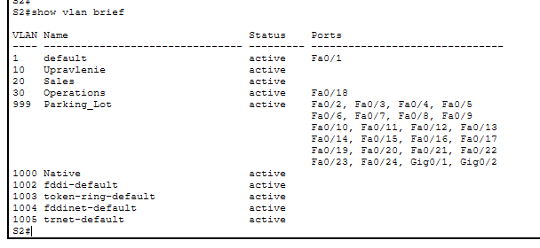
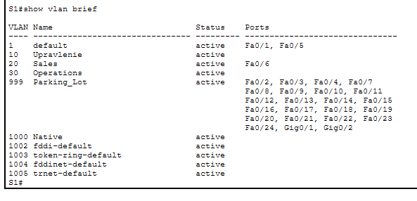
Закройте окно настройки.

### Часть 3. Конфигурация магистрального канала стандарта 802.1Q между коммутаторами

В части 3 вы вручную настроите интерфейс F0/1 как транк.

#### Шаг 1. Вручную настройте магистральный интерфейс F0/1 на коммутаторах S1 и S2.

a.	Настройка статического транкинга на интерфейсе F0/1 для обоих коммутаторов.
Откройте окно конфигурации

b.	Установите native VLAN 1000 на обоих коммутаторах.

c.	Укажите, что VLAN 10, 20, 30 и 1000 могут проходить по транку.

d.	Проверьте транки, native VLAN и разрешенные VLAN через транк.

```
S1(config)#interface f0/1
S1(config-if)#switchp
S1(config-if)#switchport mode trunk

S1(config-if)#
%LINEPROTO-5-UPDOWN: Line protocol on Interface FastEthernet0/1, changed state to down

%LINEPROTO-5-UPDOWN: Line protocol on Interface FastEthernet0/1, changed state to up

%LINEPROTO-5-UPDOWN: Line protocol on Interface Vlan10, changed state to up

S1(config-if)#switch
S1(config-if)#switchport trunk natie vlan 1000
                                   ^
% Invalid input detected at '^' marker.
	
S1(config-if)#switchport trunk native vlan 1000
S1(config-if)#switchport trunk
%CDP-4-NATIVE_VLAN_MISMATCH: Native VLAN mismatch discovered on FastEthernet0/1 (1000), with S2 FastEthernet0/1 (1).

S1(config-if)#switchport trunk allowed vlan 10,20,30,1000
S1(config-if)#no shutdown
S1(config-if)#exit
S1(config)#
```

```
S2#conf t
Enter configuration commands, one per line.  End with CNTL/Z.
S2(config)#int f0/1
S2(config-if)#switchport mode trunk
S2(config-if)#switchport trunk native vlan 1000
S2(config-if)#%SPANTREE-2-UNBLOCK_CONSIST_PORT: Unblocking FastEthernet0/1 on VLAN1000. Port consistency restored.

%SPANTREE-2-UNBLOCK_CONSIST_PORT: Unblocking FastEthernet0/1 on VLAN0001. Port consistency restored.

switchport trunk allowed vlan 10,20,30,1000
S2(config-if)#no shutdown
S2(config-if)#exit
S2(config)#
```

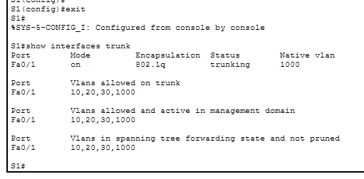
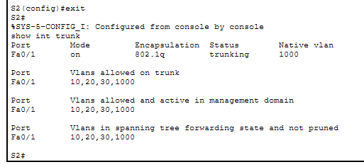

#### Шаг 2. Вручную настройте магистральный интерфейс F0/5 на коммутаторе S1.

a.	Настройте интерфейс S1 F0/5 с теми же параметрами транка, что и F0/1. Это транк до маршрутизатора.

```
S1#conf t
Enter configuration commands, one per line.  End with CNTL/Z.
S1(config)#int f0/5
S1(config-if)#switchport mode trunk
S1(config-if)#switchport trunk native vlan 1000
S1(config-if)#switchport trunk allowed vlan 10,20,30,1000
S1(config-if)#no shutdown
S1(config-if)#exit
```
b.	Сохраните текущую конфигурацию в файл загрузочной конфигурации.

c.	Проверка транкинга.

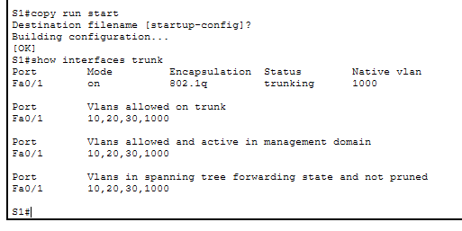

**Вопрос:**
Что произойдет, если G0/0/1 на R1 будет отключен?

**Ответ:** Транк между S1 и R1 (порты F0/5 и G0/0/1) перестанет работать. 

Закройте окно настройки.

### Часть 4. Настройка маршрутизации между сетями VLAN
#### Шаг 1. Настройте маршрутизатор.

Откройте окно конфигурации

a.	При необходимости активируйте интерфейс G0/0/1 на маршрутизаторе.

b.	Настройте подинтерфейсы для каждой VLAN, как указано в таблице IP-адресации. Все подинтерфейсы используют инкапсуляцию 802.1Q. Убедитесь, что подинтерфейсу для native VLAN не назначен IP-адрес. Включите описание для каждого подинтерфейса.

c.	Убедитесь, что вспомогательные интерфейсы работают
```
R1#
R1#conf t
Enter configuration commands, one per line.  End with CNTL/Z.
R1(config)#interface g0/0/1
R1(config-if)#no shutd
R1(config-if)#no shutdown 

R1(config-if)#
%LINK-5-CHANGED: Interface GigabitEthernet0/0/1, changed state to up

%LINEPROTO-5-UPDOWN: Line protocol on Interface GigabitEthernet0/0/1, changed state to up

R1(config-if)#exit
R1(config)#interface g0/0/1.10
R1(config-subif)#
%LINK-3-UPDOWN: Interface GigabitEthernet0/0/1.10, changed state to down

%LINEPROTO-5-UPDOWN: Line protocol on Interface GigabitEthernet0/0/1.10, changed state to up

R1(config-subif)#encapsulation dot1Q 10
R1(config-subif)#ip address 192.168.10.1 255.255.255.0
R1(config-subif)#exit
R1(config)#interface g0/0/1.20
R1(config-subif)#
%LINK-3-UPDOWN: Interface GigabitEthernet0/0/1.20, changed state to down

%LINEPROTO-5-UPDOWN: Line protocol on Interface GigabitEthernet0/0/1.20, changed state to up

R1(config-subif)#encapsulation dot1Q 20
R1(config-subif)#ip address 192.168.20.1 255.255.255.0
R1(config-subif)#interface g0/0/1.30
R1(config-subif)#
%LINK-3-UPDOWN: Interface GigabitEthernet0/0/1.30, changed state to down

%LINEPROTO-5-UPDOWN: Line protocol on Interface GigabitEthernet0/0/1.30, changed state to up

R1(config-subif)#encapsulation dot1Q 30
R1(config-subif)#ip address 192.168.30.1 255.255.255.0
R1(config-subif)#exit
R1(config)#interface g0/0/1.1000
R1(config-subif)#
%LINK-3-UPDOWN: Interface GigabitEthernet0/0/1.1000, changed state to down

%LINEPROTO-5-UPDOWN: Line protocol on Interface GigabitEthernet0/0/1.1000, changed state to up

R1(config-subif)#encapsulation dot1Q 1000 native
R1(config-subif)#end
R1#
%SYS-5-CONFIG_I: Configured from console by console

R1#copy run start
Destination filename [startup-config]? 
Building configuration...
[OK]
R1#
```

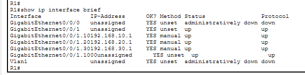


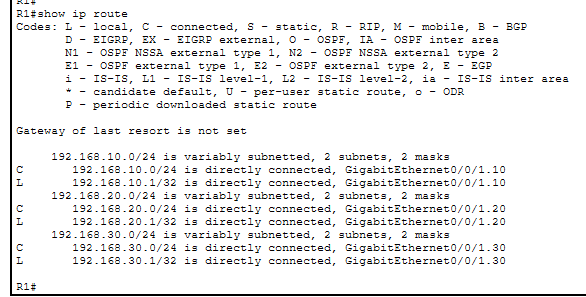
### Часть 5. Проверьте, работает ли маршрутизация между VLAN
#### Шаг 1. Выполните следующие тесты с PC-A. Все должно быть успешно.

Примечание. Возможно, вам придется отключить брандмауэр ПК для работы ping

a.	Отправьте эхо-запрос с PC-A на шлюз по умолчанию.

b.	Отправьте эхо-запрос с PC-A на PC-B.

c.	Отправьте команду ping с компьютера PC-A на коммутатор S2.
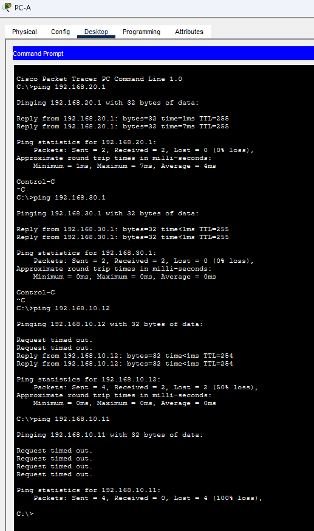
#### Шаг 2. Пройдите следующий тест с PC-B

В окне командной строки на PC-B выполните команду tracert на адрес PC-A.
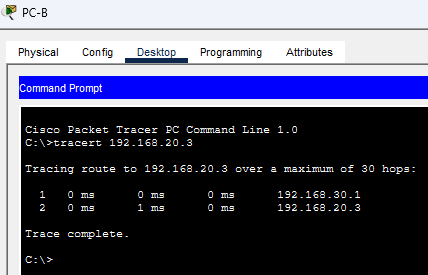
**Вопрос:**
Какие промежуточные IP-адреса отображаются в результатах?

**Ответ:** 192.168.30.1

### Сводная таблица по интерфейсам маршрутизаторов
|Модель маршрутизатора|Интерфейс Ethernet № 1|Интерфейс Ethernet № 2|Последовательный интерфейс № 1|Последовательный интерфейс № 2|
|-|-|-|-|-|
|1 800|Fast Ethernet 0/0 (F0/0)|Fast Ethernet 0/1 (F0/1)|Serial 0/0/0 (S0/0/0)|Serial 0/0/1 (S0/0/1)|
|1900	|Gigabit Ethernet 0/0 (G0/0)	|Gigabit Ethernet 0/1 (G0/1)	|Serial 0/0/0 (S0/0/0)	|Serial 0/0/1 (S0/0/1)|
|2801	|Fast Ethernet 0/0 (F0/0)	|Fast Ethernet 0/1 (F0/1)	|Serial 0/1/0 (S0/1/0)	|Serial 0/1/1 (S0/1/1)|
|2811	|Fast Ethernet 0/0 (F0/0)	|Fast Ethernet 0/1 (F0/1)	|Serial 0/0/0 (S0/0/0)	|Serial 0/0/1 (S0/0/1)|
|2900	|Gigabit Ethernet 0/0 (G0/0)	|Gigabit Ethernet 0/1 (G0/1)	|Serial 0/0/0 (S0/0/0)	|Serial 0/0/1 (S0/0/1)|
|4221	|Gigabit Ethernet 0/0/0 (G0/0/0)	|Gigabit Ethernet 0/0/1 (G0/0/1)	|Serial 0/1/0 (S0/1/0)	|Serial 0/1/1 (S0/1/1)|
|4300	|Gigabit Ethernet 0/0/0 (G0/0/0)	|Gigabit Ethernet 0/0/1 (G0/0/1)	|Serial 0/1/0 (S0/1/0)	|Serial 0/1/1 (S0/1/1)|

**Примечание**. Чтобы определить конфигурацию маршрутизатора, можно посмотреть на интерфейсы и установить тип маршрутизатора и количество его интерфейсов. Перечислить все комбинации конфигураций для каждого класса маршрутизаторов невозможно. Эта таблица содержит идентификаторы для возможных комбинаций интерфейсов Ethernet и последовательных интерфейсов на устройстве. Другие типы интерфейсов в таблице не представлены, хотя они могут присутствовать в данном конкретном маршрутизаторе. В качестве примера можно привести интерфейс ISDN BRI. Строка в скобках — это официальное сокращение, которое можно использовать в командах Cisco IOS для обозначения интерфейса.
Конец документа


## Ход выполнения стандарнтной настройки

```
enable - вход в привелигированный режим
conf t - вход в режим глобальной конфигурации
no ip domain-lookup - отключение DNS-поиска
hostname S1 - меняет имя коммутатора
service password-encryption - включает слабое шифрование (type7)
enable secret class - устанавливает пароль class для входа в привилегированный режим
banner motd # - задает сообщение при входе и символ, до которого будет считываться банер
Unauthorized access is strictly prohibited. # - сообщение и закрывающий банер символ
line con 0 - вход в настройки консольной линии (физический порт Console)
password cisco - пароль для входа в консоль
logging synchronous - отключение логов (не пишутся системные логи в окно консоли, для удобства. Например Interface G0/1 UP)
password cisco
login - обязательная команда: без неё пароль не будет запрашиваться, и устройство пустит без аутентификации
exit 0 выход в меню выше
#настройка telnet/ssh
line vty 0 4 - виртуальные линии для удалённых подключений
password cisco - пароль для входа по Telnet/SSH
login - обязательная команда: без неё пароль не будет запрашиваться, и устройство пустит без аутентификации
exit
#Настройка SVI VLAN 1 — интерфейса управления
interface vlan 1 - виртуальный интерфейс (SVI) для управления коммутатором
ip address 192.168.1.2 255.255.255.0 - присваивает IPv4-адрес и маску
no shutdown - обязательно, по умолчанию SVI выключен и не поднимается, даже если физические порты активны
end - выход из режима конфигурации в привилегированный
###Настройка завершена

### Сейчас настроен только Telnet (по умолчанию). Для SSH нужно ещё:
ip domain-name example.com
crypto key generate rsa modulus 1024
line vty 0 4
transport input all
username admin privilege 15 secret Adm1nP@55
```
Кратко скрипт:
```
enable
conf t
no ip domain-lookup
hostname S1
clock timezone MSK 3
service password-encryption
enable secret class
ip domain-name home.local
crypto key generate rsa
1024
banner motd #
Unauthorized access is strictly prohibited. #
line con 0
password cisco
login
logging synchronous 
exit
line vty 0 4
password cisco
login
transport input all
exit
interface vlan 1
ip address 192.168.1.2 255.255.255.0
no shutdown
end
username admin privilege 15 secret Adm1nP@55
clock set 18:39:00 11 Oct 2026
```

## Полные конфиги роутера и свитча ()
R1
```
R1#show run
Building configuration...

Current configuration : 1218 bytes
!
version 15.4
no service timestamps log datetime msec
no service timestamps debug datetime msec
service password-encryption
!
hostname R1
!
!
!
enable secret 5 $1$mERr$9cTjUIEqNGurQiFU.ZeCi1
!
!
!
clock timezone MSK 3
!
!
!
!
ip cef
no ipv6 cef
!
!
!
username admin privilege 15 secret 5 $1$mERr$qJb.eHvBN7S590aq.dpRL.
!
!
!
!
!
!
!
!
!
!
no ip domain-lookup
ip domain-name home.local
!
!
spanning-tree mode pvst
!
!
!
!
!
!
interface GigabitEthernet0/0/0
 no ip address
 duplex auto
 speed auto
 shutdown
!
interface GigabitEthernet0/0/1
 no ip address
 duplex auto
 speed auto
!
interface GigabitEthernet0/0/1.10
 encapsulation dot1Q 10
 ip address 192.168.10.1 255.255.255.0
!
interface GigabitEthernet0/0/1.20
 encapsulation dot1Q 20
 ip address 192.168.20.1 255.255.255.0
!
interface GigabitEthernet0/0/1.30
 encapsulation dot1Q 30
 ip address 192.168.30.1 255.255.255.0
!
interface GigabitEthernet0/0/1.1000
 encapsulation dot1Q 1000 native
 no ip address
!
interface Vlan1
 no ip address
 shutdown
!
ip classless
!
ip flow-export version 9
!
!
!
banner motd ^C
Uhodi^C
!
!
!
!
line con 0
 password 7 0822455D0A16
 logging synchronous
 login
!
line aux 0
!
line vty 0 4
 password 7 0822455D0A16
 login
!
!
!
end


R1#
```
S1
```
S1# show run
Building configuration...

Current configuration : 3068 bytes
!
version 15.0
no service timestamps log datetime msec
no service timestamps debug datetime msec
service password-encryption
!
hostname S1
!
enable secret 5 $1$mERr$9cTjUIEqNGurQiFU.ZeCi1
!
!
!
clock timezone MSK 3
!
no ip domain-lookup
ip domain-name home.local
!
!
!
spanning-tree mode pvst
spanning-tree extend system-id
!
interface FastEthernet0/1
 switchport trunk native vlan 1000
 switchport trunk allowed vlan 10,20,30,1000
 switchport mode trunk
!
interface FastEthernet0/2
 switchport access vlan 999
 switchport mode access
 shutdown
!
interface FastEthernet0/3
 switchport access vlan 999
 switchport mode access
 shutdown
!
interface FastEthernet0/4
 switchport access vlan 999
 switchport mode access
 shutdown
!
interface FastEthernet0/5
 switchport trunk native vlan 1000
 switchport trunk allowed vlan 10,20,30,1000
 switchport mode trunk
!
interface FastEthernet0/6
 switchport access vlan 20
 switchport mode access
!
interface FastEthernet0/7
 switchport access vlan 999
 switchport mode access
 shutdown
!
interface FastEthernet0/8
 switchport access vlan 999
 switchport mode access
 shutdown
!
interface FastEthernet0/9
 switchport access vlan 999
 switchport mode access
 shutdown
!
interface FastEthernet0/10
 switchport access vlan 999
 switchport mode access
 shutdown
!
interface FastEthernet0/11
 switchport access vlan 999
 switchport mode access
 shutdown
!
interface FastEthernet0/12
 switchport access vlan 999
 switchport mode access
 shutdown
!
interface FastEthernet0/13
 switchport access vlan 999
 switchport mode access
 shutdown
!
interface FastEthernet0/14
 switchport access vlan 999
 switchport mode access
 shutdown
!
interface FastEthernet0/15
 switchport access vlan 999
 switchport mode access
 shutdown
!
interface FastEthernet0/16
 switchport access vlan 999
 switchport mode access
 shutdown
!
interface FastEthernet0/17
 switchport access vlan 999
 switchport mode access
 shutdown
!
interface FastEthernet0/18
 switchport access vlan 999
 switchport mode access
 shutdown
!
interface FastEthernet0/19
 switchport access vlan 999
 switchport mode access
 shutdown
!
interface FastEthernet0/20
 switchport access vlan 999
 switchport mode access
 shutdown
!
interface FastEthernet0/21
 switchport access vlan 999
 switchport mode access
 shutdown
!
interface FastEthernet0/22
 switchport access vlan 999
 switchport mode access
 shutdown
!
interface FastEthernet0/23
 switchport access vlan 999
 switchport mode access
 shutdown
!
interface FastEthernet0/24
 switchport access vlan 999
 switchport mode access
 shutdown
!
interface GigabitEthernet0/1
 switchport access vlan 999
 switchport mode access
 shutdown
!
interface GigabitEthernet0/2
 switchport access vlan 999
 switchport mode access
 shutdown
!
interface Vlan1
 no ip address
 shutdown
!
interface Vlan10
 ip address 192.168.10.12 255.255.255.0
!
ip default-gateway 192.168.10.1
!
banner motd ^C
UhodiS1^C
!
!
!
line con 0
 password 7 0822455D0A16
 logging synchronous
 login
!
line vty 0 4
 password 7 0822455D0A16
 login
line vty 5 15
 login
!
!
!
!
end

```