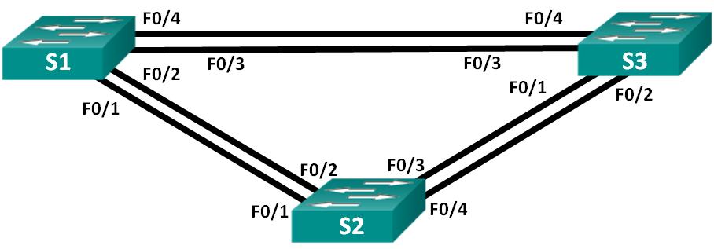
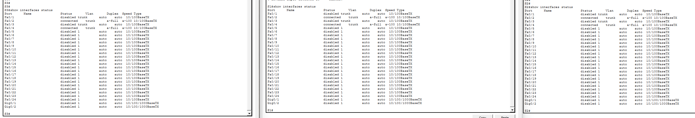
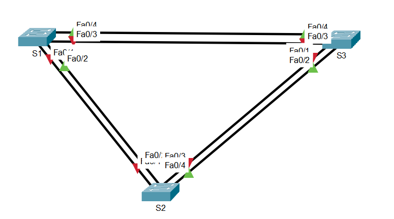
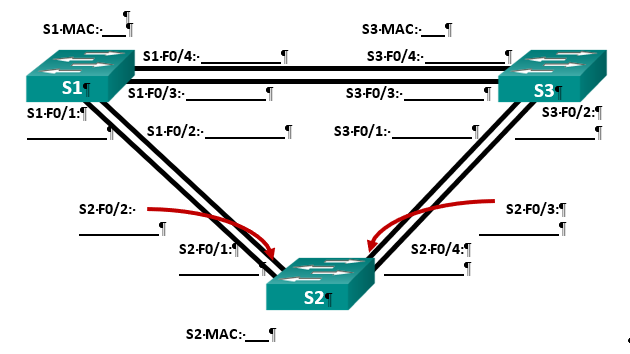
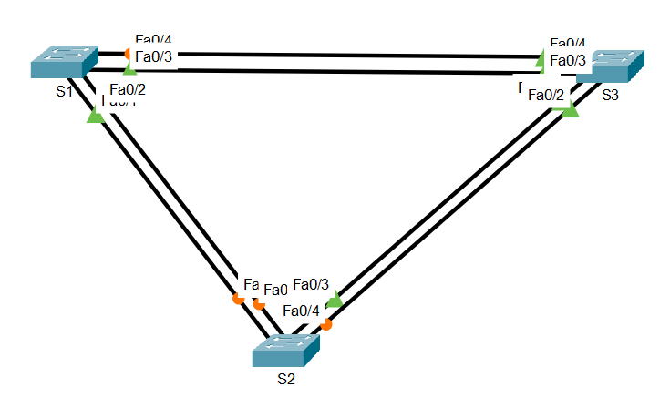

# Лабораторная работа. Развертывание коммутируемой сети с резервными каналами
## Топология
 
 ## Таблица адресации
|Устройство	|Интерфейс	|IP-адрес	|Маска подсети|
|-|-|-|-|
|S1	|VLAN 1	|192.168.1.1	|255.255.255.0|
|S2	|VLAN 1	|192.168.1.2	|255.255.255.0|
|S3	|VLAN 1	|192.168.1.3	|255.255.255.0|
## Цели
- Часть 1. Создание сети и настройка основных параметров устройства
- Часть 2. Выбор корневого моста
- Часть 3. Наблюдение за процессом выбора протоколом STP порта, исходя из стоимости портов
- Часть 4. Наблюдение за процессом выбора протоколом STP порта, исходя из приоритета портов
## Общие сведения/сценарий
Избыточность позволяет увеличить доступность устройств в топологии сети за счёт устранения единой точки отказа. Избыточность в коммутируемой сети обеспечивается посредством использования нескольких коммутаторов или нескольких каналов между коммутаторами. Когда в проекте сети используется физическая избыточность, возможно возникновение петель и дублирование кадров.

Протокол spanning-tree (STP) был разработан как механизм предотвращения возникновения петель на 2-м уровне для избыточных каналов коммутируемой сети. Протокол STP обеспечивает наличие только одного логического пути между всеми узлами назначения в сети путем намеренного блокирования резервных путей, которые могли бы вызвать петлю.

В этой лабораторной работе команда show spanning-tree используется для наблюдения за процессом выбора протоколом STP корневого моста. Также вы будете наблюдать за процессом выбора портов с учетом стоимости и приоритета.

Примечание. Используются коммутаторы Cisco Catalyst 2960s с Cisco IOS версии 15.0(2) (образ lanbasek9). Допускается использование других моделей коммутаторов и других версий Cisco IOS. В зависимости от модели устройства и версии Cisco IOS доступные команды и результаты их выполнения могут отличаться от тех, которые показаны в лабораторных работах. 

Примечание. Убедитесь, что все настройки коммутатора удалены и загрузочная конфигурация отсутствует. Если вы не уверены, обратитесь к инструктору.

## Необходимые ресурсы
- 3 коммутатора (Cisco 2960 с операционной системой Cisco IOS 15.0(2) (образ lanbasek9) или аналогичная модель)
- Консольные кабели для настройки устройств Cisco IOS через консольные порты
- Кабели Ethernet, расположенные в соответствии с топологией
## Часть 1:	Создание сети и настройка основных параметров устройства
В части 1 вам предстоит настроить топологию сети и основные параметры маршрутизаторов.
### Шаг 1:	Создайте сеть согласно топологии.
Подключите устройства, как показано в топологии, и подсоедините необходимые кабели.
### Шаг 2:	Выполните инициализацию и перезагрузку коммутаторов.
### Шаг 3:	Настройте базовые параметры каждого коммутатора.

a.	Отключите поиск DNS.

b.	Присвойте имена устройствам в соответствии с топологией.

c.	Назначьте class в качестве зашифрованного пароля доступа к привилегированному режиму.

d.	Назначьте cisco в качестве паролей консоли и VTY и активируйте вход для консоли и VTY каналов.

e.	Настройте logging synchronous для консольного канала.

f.	Настройте баннерное сообщение дня (MOTD) для предупреждения пользователей о запрете несанкционированного доступа.

g.	Задайте IP-адрес, указанный в таблице адресации для VLAN 1 на всех коммутаторах.

h.	Скопируйте текущую конфигурацию в файл загрузочной конфигурации.

```
Switch>enable
Switch#conf t
Enter configuration commands, one per line.  End with CNTL/Z.
Switch(config)#no ip domain-lookup
Switch(config)#hostname S1
S1(config)#clock timezone MSK 3
S1(config)#enable secret calss
S1(config)#service password-enc
S1(config)#service password-encryption 
S1(config)#banner motd #
Enter TEXT message.  End with the character '#'.
Unauthorized access is strictly prohibited.#

S1(config)#line console 0
S1(config-line)#password cisco
S1(config-line)#login
S1(config-line)#loggi
S1(config-line)#logging syn
S1(config-line)#logging synchronous 
S1(config-line)#exit
S1(config)#line vty 0 4
S1(config-line)#password cisco
S1(config-line)#login
S1(config-line)#exit
S1(config)#interface vlan 1
S1(config-if)#ip address 192.168.1.1 255.255.255.0
S1(config-if)# no shutdown
S1(config-if)#end
S1#
%SYS-5-CONFIG_I: Configured from console by console

S1#copy run start
Destination filename [startup-config]? 
Building configuration...
[OK]
S1#
```

```
Switch(config)#enable
% Incomplete command.
Switch(config)#configure terminal
                ^
% Invalid input detected at '^' marker.
	
Switch(config)#no ip domain-lookup
Switch(config)#hostname S1
S1(config)#enable secret class
S1(config)#service password-encryption
S1(config)#banner motd #
Enter TEXT message.  End with the character '#'.
Unauthorized access is strictly prohibited.#

S1(config)#hostname S2
S2(config)#line console 0
S2(config-line)# password cisco
S2(config-line)# login
S2(config-line)# logging synchronous
S2(config-line)# exit
S2(config)#
S2(config)#line vty 0 4
S2(config-line)# password cisco
S2(config-line)# login
S2(config-line)# exit
S2(config)#
S2(config)#interface vlan 1
S2(config-if)#ip address 192.168.1.2 255.255.255.0
S2(config-if)#no shutdown

S2(config-if)# exit
S2(config)#
S2(config)#end
S2#copy running-config startup-config
%LINK-3-UPDOWN: Interface Vlan1, changed state to down

%LINEPROTO-5-UPDOWN: Line protocol on Interface Vlan1, changed state to up

%SYS-5-CONFIG_I: Configured from console by console

S2#copy running-config startup-config
Destination filename [startup-config]? 
Building configuration...
[OK]
S2#
```

```
Switch>enable
Switch#configure terminal
Enter configuration commands, one per line.  End with CNTL/Z.
Switch(config)#no ip domain-lookup
Switch(config)#hostname S3
S3(config)#enable secret class
S3(config)#service password-encryption
S3(config)#banner motd #Unauthorized access is strictly prohibited.#
S3(config)#
S3(config)#line console 0
S3(config-line)# password cisco
S3(config-line)# login
S3(config-line)# logging synchronous
S3(config-line)# exit
S3(config)#
S3(config)#line vty 0 4
S3(config-line)# password cisco
S3(config-line)# login
S3(config-line)# exit
S3(config)#
S3(config)#interface vlan 1
S3(config-if)# ip address 192.168.1.3 255.255.255.0
S3(config-if)# no shutdown

S3(config-if)# exit
S3(config)#
S3(config)#end
S3#copy running-config startup-config
%LINK-3-UPDOWN: Interface Vlan1, changed state to down

%LINEPROTO-5-UPDOWN: Line protocol on Interface Vlan1, changed state to up

%SYS-5-CONFIG_I: Configured from console by console

S3#copy running-config startup-config
Destination filename [startup-config]? 
Building configuration...
[OK]
S3#
```
### Шаг 4:	Проверьте связь.
Проверьте способность компьютеров обмениваться эхо-запросами.
Успешно ли выполняется эхо-запрос от коммутатора S1 на коммутатор S2?	**Да**

Успешно ли выполняется эхо-запрос от коммутатора S1 на коммутатор S3?	**Да**

Успешно ли выполняется эхо-запрос от коммутатора S2 на коммутатор S3?	**Да**

Выполняйте отладку до тех пор, пока ответы на все вопросы не будут положительными.

## Часть 2:	Определение корневого моста
Для каждого экземпляра протокола spanning-tree (коммутируемая сеть LAN или широковещательный домен) существует коммутатор, выделенный в качестве корневого моста. Корневой мост служит точкой привязки для всех расчётов протокола spanning-tree, позволяя определить избыточные пути, которые следует заблокировать.

Процесс выбора определяет, какой из коммутаторов станет корневым мостом. Коммутатор с наименьшим значением идентификатора моста (BID) становится корневым мостом. Идентификатор BID состоит из значения приоритета моста, расширенного идентификатора системы и MAC-адреса коммутатора. Значение приоритета может находиться в диапазоне от 0 до 65535 с шагом 4096. По умолчанию используется значение 32768.

### Шаг 1:	Отключите все порты на коммутаторах.
```
S3(config)#interface range f0/1-24, g0/1-2
S3(config-if-range)# shutdown

%LINK-5-CHANGED: Interface FastEthernet0/1, changed state to administratively down

%LINK-5-CHANGED: Interface FastEthernet0/2, changed state to administratively down

%LINK-5-CHANGED: Interface FastEthernet0/3, changed state to administratively down

%LINK-5-CHANGED: Interface FastEthernet0/4, changed state to administratively down

%LINK-5-CHANGED: Interface FastEthernet0/5, changed state to administratively down

%LINK-5-CHANGED: Interface FastEthernet0/6, changed state to administratively down

%LINK-5-CHANGED: Interface FastEthernet0/7, changed state to administratively down

%LINK-5-CHANGED: Interface FastEthernet0/8, changed state to administratively down

%LINK-5-CHANGED: Interface FastEthernet0/9, changed state to administratively down

%LINK-5-CHANGED: Interface FastEthernet0/10, changed state to administratively down

%LINK-5-CHANGED: Interface FastEthernet0/11, changed state to administratively down

%LINK-5-CHANGED: Interface FastEthernet0/12, changed state to administratively down

%LINK-5-CHANGED: Interface FastEthernet0/13, changed state to administratively down

%LINK-5-CHANGED: Interface FastEthernet0/14, changed state to administratively down

%LINK-5-CHANGED: Interface FastEthernet0/15, changed state to administratively down

%LINK-5-CHANGED: Interface FastEthernet0/16, changed state to administratively down

%LINK-5-CHANGED: Interface FastEthernet0/17, changed state to administratively down

%LINK-5-CHANGED: Interface FastEthernet0/18, changed state to administratively down

%LINK-5-CHANGED: Interface FastEthernet0/19, changed state to administratively down

%LINK-5-CHANGED: Interface FastEthernet0/20, changed state to administratively down

%LINK-5-CHANGED: Interface FastEthernet0/21, changed state to administratively down

%LINK-5-CHANGED: Interface FastEthernet0/22, changed state to administratively down

%LINK-5-CHANGED: Interface FastEthernet0/23, changed state to administratively down

%LINK-5-CHANGED: Interface FastEthernet0/24, changed state to administratively down

%LINK-5-CHANGED: Interface GigabitEthernet0/1, changed state to administratively down

%LINK-5-CHANGED: Interface GigabitEthernet0/2, changed state to administratively down
S3(config-if-range)# exit
S3(config)#
```
### Шаг 2:	Настройте подключенные порты в качестве транковых.
```
S1(config)#interface range f0/1-4
S1(config-if-range)#switchport mode trunk
S1(config-if-range)#no shutdown

%LINK-5-CHANGED: Interface FastEthernet0/1, changed state to down

%LINK-5-CHANGED: Interface FastEthernet0/3, changed state to down
S1(config-if-range)#exit
S1(config)#
```
### Шаг 3:	Включите порты F0/2 и F0/4 на всех коммутаторах.
```
S3(config)#interface range f0/1-4
S3(config-if-range)#switchport mode trunk
S3(config-if-range)#interface range f0/2, f0/4
S3(config-if-range)#no shutdown

%LINK-5-CHANGED: Interface FastEthernet0/2, changed state to down

%LINK-5-CHANGED: Interface FastEthernet0/4, changed state to down
S3(config-if-range)#
```


### Шаг 4:	Отобразите данные протокола spanning-tree.
Введите команду show spanning-tree на всех трех коммутаторах. Приоритет идентификатора моста рассчитывается путем сложения значений приоритета и расширенного идентификатора системы. Расширенным идентификатором системы всегда является номер сети VLAN. В примере ниже все три коммутатора имеют равные значения приоритета идентификатора моста (32769 = 32768 + 1, где приоритет по умолчанию = 32768, номер сети VLAN = 1); следовательно, коммутатор с самым низким значением MAC-адреса становится корневым мостом (в примере — S2).
```
S1#show spanning-tree
VLAN0001
  Spanning tree enabled protocol ieee
  Root ID    Priority    32769
             Address     0001.97E4.804C
             Cost        19
             Port        4(FastEthernet0/4)
             Hello Time  2 sec  Max Age 20 sec  Forward Delay 15 sec

  Bridge ID  Priority    32769  (priority 32768 sys-id-ext 1)
             Address     0005.5E52.D921
             Hello Time  2 sec  Max Age 20 sec  Forward Delay 15 sec
             Aging Time  20

Interface        Role Sts Cost      Prio.Nbr Type
---------------- ---- --- --------- -------- --------------------------------
Fa0/4            Root FWD 19        128.4    P2p
Fa0/2            Desg FWD 19        128.2    P2p

S1#
```
```
S2#show spanning-tree
VLAN0001
  Spanning tree enabled protocol ieee
  Root ID    Priority    32769
             Address     0001.97E4.804C
             Cost        19
             Port        4(FastEthernet0/4)
             Hello Time  2 sec  Max Age 20 sec  Forward Delay 15 sec

  Bridge ID  Priority    32769  (priority 32768 sys-id-ext 1)
             Address     0030.A366.517D
             Hello Time  2 sec  Max Age 20 sec  Forward Delay 15 sec
             Aging Time  20

Interface        Role Sts Cost      Prio.Nbr Type
---------------- ---- --- --------- -------- --------------------------------
Fa0/4            Root FWD 19        128.4    P2p
Fa0/2            Altn BLK 19        128.2    P2p

S2#
```
```
S3#show spanning-tree
VLAN0001
  Spanning tree enabled protocol ieee
  Root ID    Priority    32769
             Address     0001.97E4.804C
             This bridge is the root
             Hello Time  2 sec  Max Age 20 sec  Forward Delay 15 sec

  Bridge ID  Priority    32769  (priority 32768 sys-id-ext 1)
             Address     0001.97E4.804C
             Hello Time  2 sec  Max Age 20 sec  Forward Delay 15 sec
             Aging Time  20

Interface        Role Sts Cost      Prio.Nbr Type
---------------- ---- --- --------- -------- --------------------------------
Fa0/2            Desg FWD 19        128.2    P2p
Fa0/4            Desg FWD 19        128.4    P2p

S3#
```
Примечание. Режим STP по умолчанию на коммутаторе 2960 — протокол STP для каждой сети VLAN (PVST).

В схему ниже запишите роль и состояние (Sts) активных портов на каждом коммутаторе в топологии.



С учетом выходных данных, поступающих с коммутаторов, ответьте на следующие вопросы.

Какой коммутатор является корневым мостом? S3

Почему этот коммутатор был выбран протоколом spanning-tree в качестве корневого моста? 
Потому что у него минимальный MAC адрес

Какие порты на коммутаторе являются корневыми портами? Те у которых стоит Root в поле Role 

Какие порты на коммутаторе являются назначенными портами? Назначенные порты — те, у которых в столбце Role стоит Desg. Назначенный порт — это порт, который «отвечает» за сегмент сети (тот, что ближе к корню) и находится в состоянии FWD (пересылка).

Какой порт отображается в качестве альтернативного и в настоящее время заблокирован? На свитче S2 Fa0/2 имеет роль Altn и статус BLK

Почему протокол spanning-tree выбрал этот порт в качестве невыделенного (заблокированного) порта?
Потому что совокупная стоимость этого маршрута будет 19+19=38, в то время как стоимость прямых маршрутов до корневого свитча будет 19.

## Часть 3:	Наблюдение за процессом выбора протоколом STP порта, исходя из стоимости портов
Алгоритм протокола spanning-tree (STA) использует корневой мост как точку привязки, после чего определяет, какие порты будут заблокированы, исходя из стоимости пути. Порт с более низкой стоимостью пути является предпочтительным. Если стоимости портов равны, процесс сравнивает BID. Если BID равны, для определения корневого моста используются приоритеты портов. Наиболее низкие значения являются предпочтительными. В части 3 вам предстоит изменить стоимость порта, чтобы определить, какой порт будет заблокирован протоколом spanning-tree.

### Шаг 1:	Определите коммутатор с заблокированным портом.
При текущей конфигурации только один коммутатор может содержать заблокированный протоколом STP порт. Выполните команду show spanning-tree на обоих коммутаторах некорневого моста. В примере ниже протокол spanning-tree блокирует порт F0/4 на коммутаторе с самым высоким идентификатором BID (S1).
```
S1#show spanning-tree
VLAN0001
  Spanning tree enabled protocol ieee
  Root ID    Priority    32769
             Address     0001.97E4.804C
             Cost        19
             Port        4(FastEthernet0/4)
             Hello Time  2 sec  Max Age 20 sec  Forward Delay 15 sec

  Bridge ID  Priority    32769  (priority 32768 sys-id-ext 1)
             Address     0005.5E52.D921
             Hello Time  2 sec  Max Age 20 sec  Forward Delay 15 sec
             Aging Time  20

Interface        Role Sts Cost      Prio.Nbr Type
---------------- ---- --- --------- -------- --------------------------------
Fa0/4            Root FWD 19        128.4    P2p
Fa0/2            Desg FWD 19        128.2    P2p

S1#
```
```
S2#show spanning-tree
VLAN0001
  Spanning tree enabled protocol ieee
  Root ID    Priority    32769
             Address     0001.97E4.804C
             Cost        19
             Port        4(FastEthernet0/4)
             Hello Time  2 sec  Max Age 20 sec  Forward Delay 15 sec

  Bridge ID  Priority    32769  (priority 32768 sys-id-ext 1)
             Address     0030.A366.517D
             Hello Time  2 sec  Max Age 20 sec  Forward Delay 15 sec
             Aging Time  20

Interface        Role Sts Cost      Prio.Nbr Type
---------------- ---- --- --------- -------- --------------------------------
Fa0/4            Root FWD 19        128.4    P2p
Fa0/2            Altn BLK 19        128.2    P2p

S2#
```
Примечание. В конкретной топологии корневой мост может отличаться от выбора порта.

### Шаг 2:	Измените стоимость порта.
Помимо заблокированного порта, единственным активным портом на этом коммутаторе является порт, выделенный в качестве порта корневого моста. Уменьшите стоимость этого порта корневого моста до 18, выполнив команду spanning-tree vlan 1 cost 18 режима конфигурации интерфейса.
```
S1(config)# interface f0/2
S1(config-if)# spanning-tree vlan 1 cost 18
```
### Шаг 3:	Просмотрите изменения протокола spanning-tree.
Повторно выполните команду show spanning-tree на обоих коммутаторах некорневого моста. Обратите внимание, что ранее заблокированный порт (S1 – F0/4) теперь является назначенным портом, и протокол spanning-tree теперь блокирует порт на другом коммутаторе некорневого моста (S3 – F0/4).
```
S2#show spanning-tree 
VLAN0001
  Spanning tree enabled protocol ieee
  Root ID    Priority    32769
             Address     0001.97E4.804C
             Cost        18
             Port        4(FastEthernet0/4)
             Hello Time  2 sec  Max Age 20 sec  Forward Delay 15 sec

  Bridge ID  Priority    32769  (priority 32768 sys-id-ext 1)
             Address     0030.A366.517D
             Hello Time  2 sec  Max Age 20 sec  Forward Delay 15 sec
             Aging Time  20

Interface        Role Sts Cost      Prio.Nbr Type
---------------- ---- --- --------- -------- --------------------------------
Fa0/4            Root FWD 18        128.4    P2p
Fa0/2            Desg LRN 19        128.2    P2p

S2#
```
```
S1#show spanning-tree 
VLAN0001
  Spanning tree enabled protocol ieee
  Root ID    Priority    32769
             Address     0001.97E4.804C
             Cost        19
             Port        4(FastEthernet0/4)
             Hello Time  2 sec  Max Age 20 sec  Forward Delay 15 sec

  Bridge ID  Priority    32769  (priority 32768 sys-id-ext 1)
             Address     0005.5E52.D921
             Hello Time  2 sec  Max Age 20 sec  Forward Delay 15 sec
             Aging Time  20

Interface        Role Sts Cost      Prio.Nbr Type
---------------- ---- --- --------- -------- --------------------------------
Fa0/4            Root FWD 19        128.4    P2p
Fa0/2            Altn BLK 19        128.2    P2p

S1#
```

Почему протокол spanning-tree заменяет ранее заблокированный порт на назначенный порт и блокирует порт, который был назначенным портом на другом коммутаторе?
Потому что STP всегда стремится минимизировать стоимость пути от каждого коммутатора до корневого моста

### Шаг 4:	Удалите изменения стоимости порта.
a.	Выполните команду no spanning-tree vlan 1 cost 18 режима конфигурации интерфейса, чтобы удалить запись стоимости, созданную ранее.
```
S1(config)# interface f0/2
S1(config-if)# no spanning-tree vlan 1 cost 18
```
b.	Повторно выполните команду show spanning-tree, чтобы подтвердить, что протокол STP сбросил порт на коммутаторе некорневого моста, вернув исходные настройки порта. Протоколу STP требуется примерно 30 секунд, чтобы завершить процесс перевода порта.
```
S2(config)#int f0/4
S2(config-if)#no spanning-tree vlan 1 cost 18
S2(config-if)#exit
S2(config)#exit
S2#
%SYS-5-CONFIG_I: Configured from console by console

S2#show spanning-tree 
VLAN0001
  Spanning tree enabled protocol ieee
  Root ID    Priority    32769
             Address     0001.97E4.804C
             Cost        19
             Port        4(FastEthernet0/4)
             Hello Time  2 sec  Max Age 20 sec  Forward Delay 15 sec

  Bridge ID  Priority    32769  (priority 32768 sys-id-ext 1)
             Address     0030.A366.517D
             Hello Time  2 sec  Max Age 20 sec  Forward Delay 15 sec
             Aging Time  20

Interface        Role Sts Cost      Prio.Nbr Type
---------------- ---- --- --------- -------- --------------------------------
Fa0/4            Root FWD 19        128.4    P2p
Fa0/2            Altn BLK 19        128.2    P2p

S2#
```
```
S1#show spanning-tree 
VLAN0001
  Spanning tree enabled protocol ieee
  Root ID    Priority    32769
             Address     0001.97E4.804C
             Cost        19
             Port        4(FastEthernet0/4)
             Hello Time  2 sec  Max Age 20 sec  Forward Delay 15 sec

  Bridge ID  Priority    32769  (priority 32768 sys-id-ext 1)
             Address     0005.5E52.D921
             Hello Time  2 sec  Max Age 20 sec  Forward Delay 15 sec
             Aging Time  20

Interface        Role Sts Cost      Prio.Nbr Type
---------------- ---- --- --------- -------- --------------------------------
Fa0/4            Root FWD 19        128.4    P2p
Fa0/2            Desg LIS 19        128.2    P2p

S1#
```
## Часть 4:	Наблюдение за процессом выбора протоколом STP порта, исходя из приоритета портов

Если стоимости портов равны, процесс сравнивает BID. Если BID равны, для определения корневого моста используются приоритеты портов. Значение приоритета по умолчанию — 128. STP объединяет приоритет порта с номером порта, чтобы разорвать связи. Наиболее низкие значения являются предпочтительными. В части 4 вам предстоит активировать избыточные пути до каждого из коммутаторов, чтобы просмотреть, каким образом протокол STP выбирает порт с учетом приоритета портов.

a.	Включите порты F0/1 и F0/3 на всех коммутаторах.

b.	Подождите 30 секунд, чтобы протокол STP завершил процесс перевода порта, после чего выполните команду show spanning-tree на коммутаторах некорневого моста. Обратите внимание, что порт корневого моста переместился на порт с меньшим номером, связанный с коммутатором корневого моста, и заблокировал предыдущий порт корневого моста.
```
S2#show spanning-tree
VLAN0001
  Spanning tree enabled protocol ieee
  Root ID    Priority    32769
             Address     0001.97E4.804C
             Cost        19
             Port        3(FastEthernet0/3)
             Hello Time  2 sec  Max Age 20 sec  Forward Delay 15 sec

  Bridge ID  Priority    32769  (priority 32768 sys-id-ext 1)
             Address     0030.A366.517D
             Hello Time  2 sec  Max Age 20 sec  Forward Delay 15 sec
             Aging Time  20

Interface        Role Sts Cost      Prio.Nbr Type
---------------- ---- --- --------- -------- --------------------------------
Fa0/4            Altn BLK 19        128.4    P2p
Fa0/2            Altn BLK 19        128.2    P2p
Fa0/3            Root FWD 19        128.3    P2p
Fa0/1            Altn BLK 19        128.1    P2p

S2#
```
```
S1#show spanning-tree
VLAN0001
  Spanning tree enabled protocol ieee
  Root ID    Priority    32769
             Address     0001.97E4.804C
             Cost        19
             Port        3(FastEthernet0/3)
             Hello Time  2 sec  Max Age 20 sec  Forward Delay 15 sec

  Bridge ID  Priority    32769  (priority 32768 sys-id-ext 1)
             Address     0005.5E52.D921
             Hello Time  2 sec  Max Age 20 sec  Forward Delay 15 sec
             Aging Time  20

Interface        Role Sts Cost      Prio.Nbr Type
---------------- ---- --- --------- -------- --------------------------------
Fa0/4            Altn BLK 19        128.4    P2p
Fa0/1            Desg FWD 19        128.1    P2p
Fa0/3            Root FWD 19        128.3    P2p
Fa0/2            Desg FWD 19        128.2    P2p

S1#
```


Какой порт выбран протоколом STP в качестве порта корневого моста на каждом коммутаторе некорневого моста? Fa0/3 на S2 и Fa0/3 на S1

Почему протокол STP выбрал эти порты в качестве портов корневого моста на этих коммутаторах?
```
Потому что у S1 (и у S2) теперь несколько путей к корневому мосту S3 с одинаковой стоимостью (все линки FastEthernet, стоимость 19). Когда стоимости равны, STP переходит к следующему критерию — BID отправителя. Но если и он одинаков (оба порта ведут к одному и тому же корневому мосту напрямую), STP сравнивает приоритет порта (port priority).

Приоритет порта по умолчанию — 128. STP объединяет приоритет с номером порта: получается Prio.Nbr = 128.<номер>. Меньшее значение предпочтительнее.

На S1:
F0/1 → 128.1
F0/2 → 128.2
F0/3 → 128.3
F0/4 → 128.4

Так как в порты 1 и 2 подлкючены оба свитча S1 и S2, то меньшее значение — 128.3, то есть F0/3. Он и становится корневым портом. Аналогично на S2.
```
## Вопросы для повторения
1.	Какое значение протокол STP использует первым после выбора корневого моста, чтобы определить выбор порта?

Стоимость пути

2.	Если первое значение на двух портах одинаково, какое следующее значение будет использовать протокол STP при выборе порта?

Bridge ID

3.	Если оба значения на двух портах равны, каким будет следующее значение, которое использует протокол STP при выборе порта?

Port Priority


## Ход выполнения стандарнтной настройки

```
enable - вход в привелигированный режим
conf t - вход в режим глобальной конфигурации
no ip domain-lookup - отключение DNS-поиска
hostname S1 - меняет имя коммутатора
service password-encryption - включает слабое шифрование (type7)
enable secret class - устанавливает пароль class для входа в привилегированный режим
banner motd # - задает сообщение при входе и символ, до которого будет считываться банер
Unauthorized access is strictly prohibited. # - сообщение и закрывающий банер символ
line con 0 - вход в настройки консольной линии (физический порт Console)
password cisco - пароль для входа в консоль
logging synchronous - отключение логов (не пишутся системные логи в окно консоли, для удобства. Например Interface G0/1 UP)
password cisco
login - обязательная команда: без неё пароль не будет запрашиваться, и устройство пустит без аутентификации
exit 0 выход в меню выше
#настройка telnet/ssh
line vty 0 4 - виртуальные линии для удалённых подключений
password cisco - пароль для входа по Telnet/SSH
login - обязательная команда: без неё пароль не будет запрашиваться, и устройство пустит без аутентификации
exit
#Настройка SVI VLAN 1 — интерфейса управления
interface vlan 1 - виртуальный интерфейс (SVI) для управления коммутатором
ip address 192.168.1.2 255.255.255.0 - присваивает IPv4-адрес и маску
no shutdown - обязательно, по умолчанию SVI выключен и не поднимается, даже если физические порты активны
end - выход из режима конфигурации в привилегированный
###Настройка завершена

### Сейчас настроен только Telnet (по умолчанию). Для SSH нужно ещё:
ip domain-name example.com
crypto key generate rsa modulus 1024
line vty 0 4
transport input all
username admin privilege 15 secret Adm1nP@55
```
Кратко скрипт:
```
enable
conf t
no ip domain-lookup
hostname S1
clock timezone MSK 3
service password-encryption
enable secret class
ip domain-name home.local
crypto key generate rsa
1024
banner motd #
Unauthorized access is strictly prohibited. #
line con 0
password cisco
login
logging synchronous 
exit
line vty 0 4
password cisco
login
transport input all
exit
interface vlan 1
ip address 192.168.1.2 255.255.255.0
no shutdown
end
username admin privilege 15 secret Adm1nP@55
clock set 18:39:00 11 Oct 2026
```